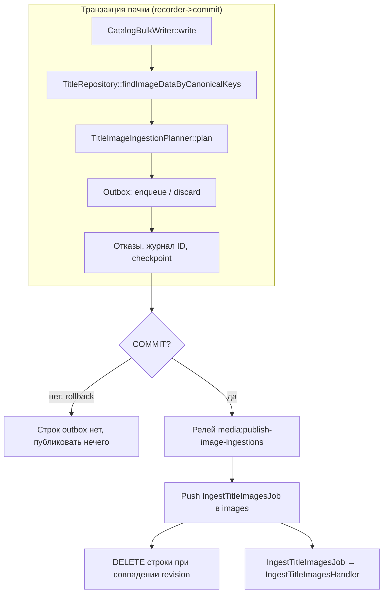

# Связка импорта с загрузкой изображений через transactional outbox

Дата: 2026-11-17. Ветка: `d38e5e9`. Идентификаторы кода — на английском, пояснения — на русском.

Статус: реализовано 2026-11-20, ветка `d38e5e9`. Итоги проверки — в разделе «Проверка».

Связанные документы:

- [docs/TZ.md](../../TZ.md) — 6.3.1, 6.3.2, 6.3.3, 7.2
- [сжатие изображений](../image_compression/Image_compression.md) — п. 10 «Точка стыковки с импортом», п. 11, п. 12
- [сохраняющий sink](../catalog_candidate_sink/Catalog_candidate_sink.md) — риск 3 «Картинки не ставятся в очередь»
- [доработки оркестратора](../filter_data_from_providers/Import_reliability_followup_plan.md) — п. 5 «Публиковать обязательные задания для медиа через outbox»
- [план оркестратора](../filter_data_from_providers/Import_collection_and_packing_plan.md) — атомарное подтверждение пачки
- [соглашения](../../Development_conventions.md)

---

## 1. Задача

Подключить постановку `IngestTitleImagesJob` к импорту каталога так, чтобы:

1. задание на картинки появлялось **только для подтверждённой пачки**: при откате пачки ни
   одно задание не уходит, и ни один байт не попадает в хранилище;
2. задание для подтверждённой пачки **не терялось** при падении процесса, недоступности
   Redis или падении воркера;
3. в транзакции пачки не было сетевых операций: HTTP, Redis, S3;
4. картинки, у которых SHA-256 внешнего URL совпадает с сохранённым хешем, не обрабатывались
   повторно;
5. сбой обработки картинок никогда не откатывал и не блокировал запись тайтла.

Пункты 1–3 — требования п. 5 плана доработок: «внешние задания появляются только для
подтверждённых изменений» и «не выполнять HTTP-запросы и обработку изображений внутри
транзакции батча». Пункты 4–5 — требования п. 10–12 документа о сжатии изображений.

### 1.1. Что входит

- Таблица outbox `title_image_ingestions` и её репозиторий.
- Планирование заданий в `CatalogCandidateSink::flush()`: сверка хешей и запись в outbox в
  транзакции пачки.
- Релей: use case и консольная команда, которые публикуют задания из outbox в очередь `images`.
- Подключение планировщика Laravel (в проекте его ещё нет).
- `posterUrl` в `IngestTitleImagesJob` и `IngestTitleImagesHandler` становится nullable: так
  можно ставить задание только на баннер.
- Конфигурация, логирование, обязательные тесты.
- Правки связанных документов (раздел 17).

### 1.2. Что не входит

| Что | Почему |
| --- | --- |
| Таблица `external_ids` и приоритет поставщиков | Отдельная задача (риск 1 сохраняющего sink). Пока её нет, два поставщика с одним `canonical_key` по очереди переписывают картинки, см. раздел 15 |
| Ручная загрузка постера админом | Появится с редактированием каталога (ТЗ 4.1.2.5). Правило защиты от импорта зафиксировано в разделе 15 как открытое решение |
| Пересчёт `is_incomplete` после окончательного отказа картинки | Открытое решение, раздел 15 |
| Ускоренный запуск релея сразу после commit пачки | Опциональный этап 2, раздел 8.6 |
| Упорядочивание заданий одного тайтла по версии источника | Известное ограничение, раздел 14 |
| Регламентная уборка объектов-сирот в бакете | Отдельная задача из документа о сжатии |

---

## 2. Исходное состояние

```text
ImportTitlesFromProvider::process()
  sink->consume(candidate, decision)              буфер в памяти
  recorder->commit(run, batch, write)             DB::transaction, import_runs FOR UPDATE
    lock->assertOwned()
    sink->flush() | sink->finish()
      TitleKeyResolver::resolve()
      CatalogTitlePackDataFactory::create()       posterUrl и bannerUrl ещё есть
      CatalogAttributeDefinitionValidator::validate()
      CatalogPacker::pack()                       URL отбрасываются
      CatalogBulkWriter::write()                  savepoint; poster_key и хеши не трогает
    import_rejections, import_processed_titles, checkpoint
  COMMIT
  afterCommit: warning о коллизиях
```

- `IngestTitleImagesJob` никто не диспатчит, тайтлы появляются без постеров.
- URL постера и баннера существуют только в памяти sink — в `CatalogTitlePackData`.
- Владелец колонок `poster_key`, `poster_thumb_key`, `banner_key`, `poster_source_hash` и
  `banner_source_hash` — медиа-job. Импорт их не пишет (п. 9.2 документа о сжатии).
- Очередь — Redis с `after_commit => false`. Супервизор `images` в Horizon уже настроен.
- Планировщик Laravel не подключён: в `bootstrap/app.php` нет `withSchedule()`, а
  `routes/console.php` отсутствует.

Поэтому точка подключения — sink, а не use case. `ImportTitlesFromProvider` не знает про
каталог: он работает через `CandidateSinkContract`, а у этого контракта есть и
`LogCandidateSink`. Контракт `CandidateSinkContract` не меняется.

---

## 3. Почему не `dispatch` и не `afterCommit`

### 3.1. `dispatch` внутри `flush()`

Задание попадает в Redis сразу, до COMMIT пачки.

| Что случилось | Последствие |
| --- | --- |
| Пачка откатилась после `write()`: ошибка журнала ID, отказов, checkpoint или потеря владения | Задание в очереди. Для нового тайтла — `TitleNotFoundException` и сразу failed. Для существующего — в каталог попадает картинка из неподтверждённой пачки |
| Воркер забрал задание раньше COMMIT | Новую строку тайтла он не видит: `TitleNotFoundException`, постоянный failed |
| Resume повторил откатившуюся пачку | Второе задание на тот же тайтл |

### 3.2. `DB::afterCommit` или `ShouldQueueAfterCommit`

Откат решается, но между COMMIT и Redis остаётся окно, в котором задание теряется.

1. Процесс убит, или Redis недоступен после COMMIT. Пачка уже подтверждена, её ID лежат в
   `import_processed_titles`, и resume их не повторит. Задание пропало, URL нигде не сохранён.
   Восстановить его может только следующий импорт этих тайтлов.
2. `dispatch` бросил исключение в колбэке. В Laravel 13 `ManagesTransactions::transaction()`
   выполняет колбэки после `PDO::commit()` и не перехватывает их исключения. Последовательность:
   - пачка N уже записана, `checkpoint = N`;
   - колбэки после упавшего не выполняются, остаток заданий пачки теряется;
   - исключение выходит из `recorder->commit()`, `ImportTitlesFromProvider::process()` ловит
     его и вызывает `recorder->fail()`;
   - подтверждённый прогон получает статус `failed`, команда возвращает `FAILURE`;
   - `--resume` начинает с `checkpoint = N`, и потерянные задания пачки N больше не появятся.

   Если обернуть `dispatch` в `try/catch`, прогон перестанет падать, но задания всё равно
   потеряются, только молча.

Корень проблемы: Redis не участвует в транзакции PostgreSQL. Атомарно с пачкой можно
записать только то, что лежит в той же базе. Отсюда outbox.

---

## 4. Решение

Задание на картинки записывается строкой в таблицу outbox **в той же транзакции**, что
тайтлы, журнал ID и checkpoint. Отдельный релей по расписанию читает подтверждённые строки,
ставит `IngestTitleImagesJob` в очередь `images` и удаляет строку.

```text
Импорт: одна транзакция на пачку           Релей: раз в минуту                Очередь images
────────────────────────────────           ───────────────────                ──────────────
BEGIN
  upsert titles (savepoint)
  SELECT хеши записанных тайтлов
  план: что поставить, что снять
  upsert / delete title_image_ingestions
  import_rejections, processed ids
  checkpoint = N
COMMIT ───────────────────────────────►    SELECT … WHERE id > :cursor
                                            push IngestTitleImagesJob ──────► скачать, сжать,
                                            DELETE … WHERE id AND revision     положить в S3,
                                                                               savePoster/saveBanner,
                                                                               удалить старый префикс
```



### 4.1. Ответ на вопрос «как откатываются картинки, если импорт упал»

Откатывать нечего: обработка картинок для неподтверждённой пачки не начинается.

- Строки outbox откатываются PostgreSQL вместе с пачкой.
- Релей читает только подтверждённые данные (READ COMMITTED) и не видит строки
  незакоммиченной пачки.
- Пачки до упавшей подтверждены вместе со своими тайтлами. Их картинки обрабатываются
  правильно: каталог и outbox подтверждаются одной транзакцией и поэтому всегда согласованы.
- Resume повторяет упавшую пачку и заново записывает её строки outbox.

### 4.2. Источник истины

Outbox — **буфер доставки**, а не источник истины о том, нужна ли работа. Работа нужна,
пока SHA-256 текущего внешнего URL не совпадает с `*_source_hash` в строке тайтла. Хеш
пишет только успешная job.

Следствие: любая потеря строки outbox (ручная очистка, откат релиза, `down` миграции)
восстанавливается следующим импортом этих тайтлов. Хеш не записан, поэтому планировщик
поставит задание снова. Это делает схему устойчивой к ошибкам эксплуатации.

---

## 5. Модель данных

### 5.1. Таблица `title_image_ingestions`

Миграция: `database/migrations/2026_11_17_000001_create_title_image_ingestions_table.php`.

| Колонка | Тип | Описание |
| --- | --- | --- |
| `id` | `bigint` PK | Порядок публикации (FIFO по первой постановке) и курсор релея |
| `canonical_key` | `string`, unique, FK → `titles.canonical_key`, `ON DELETE CASCADE` | Одна строка на тайтл |
| `poster_url` | `text`, nullable | Текущий внешний URL постера, если вариант нужно обработать |
| `banner_url` | `text`, nullable | Текущий внешний URL баннера, если вариант нужно обработать |
| `revision` | `unsigned bigint`, default 1 | Растёт при каждом повторном upsert. Защищает от удаления более новой версии строки |
| `created_at` | `timestamp` | Время первой постановки. По нему считается возраст backlog |
| `updated_at` | `timestamp` | Время последнего upsert |

Ограничения:

- PostgreSQL: `CHECK (poster_url IS NOT NULL OR banner_url IS NOT NULL)` через
  `DB::statement` под условием драйвера `pgsql`. В SQLite то же правило обеспечивает
  код (раздел 6.2).
- Индекс по `created_at` не нужен: возраст backlog — `min(created_at)` по таблице, размер
  которой ограничен числом тайтлов.

Почему одна строка на тайтл, а не журнал событий:

- повторный импорт до публикации заменяет URL, а не копит устаревшие задания;
- размер outbox ограничен размером каталога, независимо от числа прогонов;
- релей всегда публикует последнее известное состояние.

Почему внешний URL можно хранить здесь, хотя п. 10 документа о сжатии запрещает: запрет
относится к `titles`. Там URL не нужен после обработки и устаревает. В outbox URL лежит
только до публикации задания и удаляется вместе со строкой. Формулировку в документе о
сжатии нужно уточнить (раздел 17).

### 5.2. Upsert и `revision`

```sql
INSERT INTO title_image_ingestions (canonical_key, poster_url, banner_url, revision, created_at, updated_at)
VALUES (...)
ON CONFLICT (canonical_key) DO UPDATE SET
    poster_url = excluded.poster_url,
    banner_url = excluded.banner_url,
    revision   = title_image_ingestions.revision + 1,
    updated_at = excluded.updated_at;
```

`created_at` при конфликте не обновляется: возраст строки отражает время ожидания первой
постановки. Реализация — `DB::table()->upsert()` с `DB::raw` для `revision`, как в
`TitleBulkWriter`. Чанки по 1000 строк.

`revision` растёт и при совпадающих URL. Это осознанное упрощение: худший случай — одно
лишнее задание, которое хендлер отбросит сверкой хеша. Сравнение URL с NULL-семантикой
(`IS DISTINCT FROM`) различается в PostgreSQL и SQLite, поэтому в SQL его не переносим.

---

## 6. Планирование в пачке

### 6.1. Место вызова

`CatalogCandidateSink::flush()`, сразу после `writer->write()`, внутри транзакции
`recorder->commit()` и на том же соединении:

```php
if ($packedTitles !== []) {
    $this->definitionValidator->validate($packedTitles);
    $this->writer->write($this->packer->pack(new CatalogPackInput($packedTitles, [])));
    $plan = $this->images->handle(array_map(TitleImageSource::fromPackData(...), $packedTitles));
    DB::afterCommit(static fn () => self::reportImagePlan($plan));
}
```

- Передаются только тайтлы из `resolution->resolved`. Кандидаты, исключённые коллизией, не
  записаны, и заданий для них нет.
- `abort()` не меняется: незаписанное в базу откатывается транзакцией.
- `finish()` вызывает `flush()`, поэтому финальная пачка планируется так же.

`RecordTitleImageIngestionsHandler::handle(list<TitleImageSource>)` — use case уровня
Application:

1. Читает хеши: `TitleRepositoryContract::findImageDataByCanonicalKeys(list<string>)`, один
   `SELECT` на чанк из 1000 ключей.
2. Вызывает чистый `TitleImageIngestionPlanner::plan()`.
3. Пишет результат: `outbox->enqueue($plan->enqueue)` и `outbox->discard($plan->discard)`.

### 6.2. Правила планирования

Для каждого записанного тайтла считаются два флага:

```text
needPoster = posterUrl !== null && sha256(posterUrl) !== stored.posterSourceHash
needBanner = bannerUrl !== null && sha256(bannerUrl) !== stored.bannerSourceHash
```

| needPoster | needBanner | Действие | Payload |
| --- | --- | --- | --- |
| да | да | enqueue | `posterUrl`, `bannerUrl` |
| да | нет | enqueue | `posterUrl`, `bannerUrl = null` |
| нет | да | enqueue | `posterUrl = null`, `bannerUrl` |
| нет | нет | discard | Снять ожидающую строку, если она есть |

Правила:

- **Хеш** — `hash('sha256', $url)` от строки без нормализации, ровно как в
  `IngestTitleImagesHandler`. Расхождение алгоритмов даёт бесконечные повторные задания.
  Поэтому функция выносится в одно место, например `TitleImageSourceHash::of()`, и
  используется в обоих.
- **Discard обязателен.** Сценарий: в outbox ждёт URL2, а поставщик вернул URL1, который уже
  обработан и совпадает с хешем. Без discard релей опубликует устаревший URL2, и постер
  откатится к неактуальной версии.
- **URL пропал у поставщика** (`null`): вариант не ставится. Уже сохранённые ключи и
  объекты не удаляются — это симметрично правилу ТЗ 6.3.3 «перестал приходить — не удалять».
- **Пустой URL** (`''` или одни пробельные символы) считается отсутствующим, как в
  `CompletenessRule`: вариант не ставится. Иначе хеш пустой строки никогда не совпадёт с
  сохранённым, загрузчик постоянно отказывает, и каждый импорт ставит задание снова. Непустой
  URL не обрезается и хешируется как есть.
- **Нет ни одного URL**: строка не ставится, ожидающая строка снимается. Флаг неполноты
  выставляет фильтр, как и раньше.
- **Строки тайтла нет** после `write()` в той же транзакции — нарушение инварианта, а не
  бизнес-ситуация. Планировщик бросает `LogicException`, пачка откатывается.
- **Валидация URL** (схема, хост, приватные адреса) остаётся в `HttpImageDownloader` и
  `PublicHostResolver`. Планировщик считает URL непрозрачной строкой. Отказ загрузчика — это
  постоянная ошибка job (п. 12 документа о сжатии), а не причина откатывать импорт.

### 6.3. Согласованность чтения хешей

Хеши читаются после upsert тайтлов в той же транзакции. Строки `titles` пачки уже
заблокированы этим upsert, поэтому:

- `savePoster` или `saveBanner` параллельной job на тот же тайтл ждёт COMMIT пачки и не
  меняет хеш между чтением и записью outbox;
- если job закоммитила хеш до начала пачки, планировщик его видит и задание не ставит.

Худший случай гонки — одно лишнее задание, которое хендлер отбросит сверкой хеша.

### 6.4. Цена в транзакции пачки

На пачку добавляются три запроса или их чанки: `SELECT` хешей, upsert outbox, `DELETE` по
discard. Сетевых операций нет. Длительность транзакции пачки меняется незначительно
относительно upsert тайтлов и атрибутов.

---

## 7. Изменения в Media

### 7.1. `posterUrl` становится nullable

`IngestTitleImagesJob::__construct(string $canonicalKey, ?string $posterUrl, ?string $bannerUrl)`
и `IngestTitleImagesHandler::handle(string $canonicalKey, ?string $posterUrl, ?string $bannerUrl)`.

- `ingestPoster()` при `null` возвращает `null` без скачивания, так же как `ingestBanner()`.
- Конструктор job бросает `InvalidArgumentException`, если оба URL равны `null`. Пустое
  задание — ошибка вызывающего кода, а не повод занимать воркер.
- Follow-up при повторяемой ошибке переносит payload как есть.
- Совместимость: задания, уже сериализованные в Redis со строковым `posterUrl`,
  десериализуются без изменений.
- Существующие тесты передают строку и не затрагиваются.

### 7.2. Без изменений

- `WithoutOverlapping($canonicalKey)`, `remainingAttempts`, `$tries`, `$timeout`.
- Сверка хеша в хендлере перед скачиванием. Она остаётся второй линией защиты от
  повторной доставки (раздел 9, I4).
- Порядок «сначала строка, потом удаление старого префикса».

---

## 8. Релей

### 8.1. Компоненты

| Слой | Класс | Ответственность |
| --- | --- | --- |
| Interfaces | `PublishTitleImageIngestionsCommand` (`media:publish-image-ingestions {--limit=}`) | Разбор опций, вывод итогов, код возврата |
| Application | `PublishTitleImageIngestionsHandler` | Алгоритм публикации, backpressure, итог |
| Application | `TitleImageIngestionOutboxContract` | `enqueue`, `discard`, `pending`, `acknowledge`, `backlog` |
| Application | `TitleImageIngestionQueueContract` | `size(): int`, `push(PendingTitleImageIngestion): void` |
| Infrastructure | `EloquentTitleImageIngestionOutbox` | SQL outbox |
| Infrastructure | `LaravelTitleImageIngestionQueue` | `Queue::connection()->size(images)` и `dispatch(new IngestTitleImagesJob(...))` |

Очередь закрыта контрактом, а не вызовом `dispatch()` напрямую. Так алгоритм релея
тестируется unit-тестом с подменой отказа Redis, без `Queue::fake()` и без инфраструктуры.

### 8.2. Алгоритм

```text
budget  = min(--limit, images.outbox.publish_limit)
try   size = queue.size()
catch Throwable → лог error, итог «ошибка очереди», FAILURE, ничего не публикуем
room    = images.outbox.max_queue_size - size
если room <= 0 → итог «очередь заполнена», SUCCESS, ничего не публикуем
budget  = min(budget, room)
cursor  = 0
пока budget > 0:
    rows = outbox.pending(afterId: cursor, limit: min(chunk, budget))   ORDER BY id
    если rows пуст → выход
    для каждой row:
        cursor = row.id
        try   queue.push(row)
        catch Throwable → лог error, итог «ошибка очереди», FAILURE, выход из цикла
        если outbox.acknowledge(row.id, row.revision) → published++
        иначе                                         → superseded++
        budget--
итог: published, superseded, backlog (count, oldest age)
```

- **Сначала push, потом delete.** Падение между ними даёт повторную доставку, а не потерю.
  Повтор безопасен (раздел 9, I4).
- **`acknowledge`** = `DELETE FROM title_image_ingestions WHERE id = ? AND revision = ?`.
  Ноль удалённых строк означает, что импорт успел обновить строку. Она остаётся, и следующий
  запуск опубликует новую версию. Задание по старой версии уже в очереди и будет отброшено
  или перезаписано — раздел 14.
- **Курсор по `id`**, а не «первые N строк». Строки с несовпавшей ревизией не перечитываются
  в том же запуске, и бесконечного цикла нет.
- **Блокировки строк не держатся во время push в Redis.** Импорт не ждёт релей, а сетевой
  вызов не выполняется под блокировкой базы. Корректность не зависит от взаимного
  исключения релеев: два параллельных релея дают только дубли, которые безопасны.
- **Ошибка `queue.size()`** обрабатывается так же, как ошибка push: недоступный Redis
  не должен ронять команду стектрейсом без записи в лог.
- **Первая ошибка push останавливает запуск.** При недоступном Redis нет смысла пытаться
  ещё 499 раз и засорять лог. Строки остаются, следующий запуск через минуту повторит.

### 8.3. Backpressure

Полный импорт ставит до ~25 тысяч строк, а супервизор `images` обрабатывает единицы тайтлов
в секунду. Outbox — естественный буфер: релей держит в Redis не больше `max_queue_size`
заданий. Это даёт:

- ограниченную память Redis;
- видимость backlog в одном месте — в таблице;
- возможность снять неактуальные строки через discard до публикации, а не после.

### 8.4. Расписание

В `bootstrap/app.php`:

```php
->withSchedule(function (Schedule $schedule): void {
    $schedule->command('media:publish-image-ingestions')
        ->everyMinute()
        ->withoutOverlapping(10)
        ->onOneServer();
})
```

- `withoutOverlapping` и `onOneServer` — оптимизация, а не условие корректности. Им нужен
  кеш с атомарными блокировками: `redis` или `database`.
- Эксплуатационное требование: в окружении должен работать `php artisan schedule:work`
  (контейнер) или cron `* * * * * php artisan schedule:run`. Без него backlog растёт, и
  это видно по алерту возраста (раздел 11).

### 8.5. Коды возврата и вывод команды

| Ситуация | Код | Вывод |
| --- | --- | --- |
| Опубликовано ≥ 0, ошибок нет | `SUCCESS` | Таблица: Published, Superseded, Backlog, Oldest age |
| Очередь заполнена | `SUCCESS` | Строка «queue is full», backlog |
| Ошибка `queue.size()` или push | `FAILURE` | Сообщение исключения, сколько успели опубликовать |
| `--limit` не положительное целое | `FAILURE` | `Limit must be a positive integer.` (как в `import:run`) |

### 8.6. Этап 2 (опционально): ускоренный запуск

Если задержка до минуты станет заметной, sink может в `DB::afterCommit` ставить лёгкое
задание `PublishTitleImageIngestionsJob` в очередь `default`, проглатывая любые ошибки.
Расписание остаётся гарантией доставки, ускоритель — best-effort. В MVP не делается: для
каталога с ежедневным обновлением минута некритична.

---

## 9. Инварианты

| # | Инвариант | Чем обеспечен |
| --- | --- | --- |
| I1 | Строка outbox существует только для тайтла, подтверждённого той же транзакцией | Запись в `flush()` внутри `recorder->commit()`, одно соединение |
| I2 | Задание публикуется только из подтверждённой строки | Релей — отдельный процесс, READ COMMITTED |
| I3 | В транзакции пачки нет сетевых операций | Sink пишет только в БД; Redis трогает лишь релей |
| I4 | Доставка «хотя бы один раз»; повтор безопасен | Push до delete; `WithoutOverlapping` и сверка хеша в хендлере |
| I5 | После COMMIT пачки для каждого записанного тайтла строка outbox есть тогда и только тогда, когда хотя бы один вариант не совпал по хешу; в строке ровно несовпавшие текущие URL | Upsert и discard в одном плане |
| I6 | Импорт не пишет `poster_key`, `poster_thumb_key`, `banner_key` и `*_source_hash` | `TitleBulkWriter` без изменений |
| I7 | Сбой картинок не откатывает и не блокирует тайтл | Job выполняется после COMMIT в своём процессе |
| I8 | Потеря строки outbox восстанавливается следующим импортом | Источник истины — хеш в `titles` (раздел 4.2) |

---

## 10. Сценарии сбоев

| # | Где сбой | Состояние после | Восстановление |
| --- | --- | --- | --- |
| 1 | Ошибка в `commit()` после `write()` и планирования: журнал ID, отказы, checkpoint | Тайтлы и строки outbox пачки откатились | Resume повторяет пачку и пишет строки заново |
| 2 | Процесс импорта убит посреди пачки | PostgreSQL прерывает транзакцию, как в п. 1 | Resume |
| 3 | Прогон упал на пачке N | Пачки 1…N-1 и их строки outbox подтверждены, N откатилась | Релей публикует 1…N-1, resume дописывает N |
| 4 | Потеря владения прогоном (`assertOwned`) | Как в п. 1 | Владелец-победитель пишет свои пачки |
| 5 | Redis недоступен при публикации | `queue.size()` или push бросил исключение, строка не удалена | Следующий запуск через минуту |
| 6 | Релей убит между push и delete | Задание в очереди, строка осталась | Повторная публикация; хендлер отбросит повтор по хешу или `WithoutOverlapping` |
| 7 | База недоступна при `acknowledge` | Как в п. 6 | Как в п. 6 |
| 8 | Импорт обновил строку между `pending` и `acknowledge` | `DELETE` удалил 0 строк, новая ревизия осталась | Следующий запуск публикует новую ревизию |
| 9 | Поставщик вернул уже обработанный URL, пока строка ждала | Discard удалил строку в транзакции пачки | Не требуется |
| 10 | Job упала окончательно: три повторяемых отказа или `TitleNotFoundException` | Задание в failed (Horizon), строки outbox уже нет, хеш не записан | Следующий импорт снова поставит задание (I8); ручной retry в Horizon |
| 11 | Постоянная ошибка картинки: 404, формат, лимиты | Job успешна, хеш варианта не записан | Каждый следующий импорт ставит вариант снова. См. раздел 15, п. 4 |
| 12 | Два релея одновременно | Дубли заданий | Безопасно (I4) |
| 13 | Планировщик не запущен | Backlog растёт | Алерт возраста backlog (раздел 11) |
| 14 | Тайтл физически удалён | Строка удалена каскадом | Не требуется |

---

## 11. Наблюдаемость

Логи (контекст — массивом, как во всём проекте):

| Событие | Уровень | Контекст |
| --- | --- | --- |
| Итог запуска релея | `info` | `published`, `superseded`, `backlog`, `oldest_age_seconds` |
| Очередь заполнена | `info` | `queue_size`, `max_queue_size`, `backlog` |
| Ошибка `queue.size()` | `error` | `exception`, `backlog` |
| Ошибка push | `error` | `canonical_key`, `outbox_id`, `revision`, `exception`, `published_before_failure` |
| Возраст backlog выше порога | `warning` | `oldest_age_seconds`, `stale_after_minutes`, `backlog_count` |
| Итог планирования пачки | `debug` | `enqueued`, `discard_requested`, `skipped` |

- Логирование в sink не должно выпускать исключения наружу. Лог итога планирования пишется
  через `DB::afterCommit` с защитой, как предупреждение о коллизиях, чтобы откатившаяся пачка
  не оставляла ложных записей (п. 1.2 плана доработок).
- Задания: Horizon, супервизор `images` — throughput, failed, время ожидания.
- Алерт: `oldest_age_seconds > stale_after_minutes * 60` дольше двух запусков подряд.
  Возможные причины: планировщик не работает, Redis лежит, очередь `images` стоит.

---

## 12. Конфигурация

Новая секция в `config/images.php`:

```php
'outbox' => [
    'publish_limit'       => (int) env('IMAGES_OUTBOX_PUBLISH_LIMIT', 500),
    'chunk'               => (int) env('IMAGES_OUTBOX_CHUNK', 100),
    'max_queue_size'      => (int) env('IMAGES_OUTBOX_MAX_QUEUE_SIZE', 1000),
    'stale_after_minutes' => (int) env('IMAGES_OUTBOX_STALE_AFTER_MINUTES', 60),
],
```

- Значения читаются через `ImageConfig` с проверкой «положительное целое». Неверное значение —
  `ImageConfigurationException` при сборке релея, до первой публикации. Это тот же подход,
  что `ImportCheckpointIntervals`.
- Переменные добавляются в `.env.example` с комментариями.

---

## 13. Код

### 13.1. Новые файлы

| Файл | Назначение |
| --- | --- |
| `database/migrations/2026_11_17_000001_create_title_image_ingestions_table.php` | Таблица outbox, FK, CHECK для PostgreSQL |
| `app/Infrastructure/Persistence/Eloquent/Models/Media/TitleImageIngestion.php` | Модель с константами `TABLE_NAME` и `FIELD_*` |
| `app/Application/Media/DTOs/TitleImageSource.php` | `canonicalKey`, `?posterUrl`, `?bannerUrl` из пачки; `fromPackData()` |
| `app/Application/Media/DTOs/TitleImageIngestionRequest.php` | Что поставить: ключ и несовпавшие URL; инвариант «хотя бы один URL» |
| `app/Application/Media/DTOs/TitleImageIngestionPlan.php` | `enqueue` и `discard` |
| `app/Application/Media/DTOs/PendingTitleImageIngestion.php` | Строка outbox для релея: `id`, `revision`, ключ, URL |
| `app/Application/Media/DTOs/TitleImageIngestionBacklog.php` | `count`, `oldestCreatedAt` |
| `app/Application/Media/DTOs/PublishTitleImageIngestionsResult.php` | Итог запуска релея |
| `app/Application/Media/Services/TitleImageSourceHash.php` | Единственная функция хеша URL |
| `app/Application/Media/Services/TitleImageIngestionPlanner.php` | Чистые правила раздела 6.2 |
| `app/Application/Media/UseCases/RecordTitleImageIngestionsHandler.php` | Чтение хешей → план → outbox |
| `app/Application/Media/UseCases/PublishTitleImageIngestionsHandler.php` | Алгоритм раздела 8.2 |
| `app/Application/Media/Contracts/TitleImageIngestionOutboxContract.php` | Контракт outbox |
| `app/Application/Media/Contracts/TitleImageIngestionQueueContract.php` | Контракт очереди |
| `app/Infrastructure/Persistence/Eloquent/Media/EloquentTitleImageIngestionOutbox.php` | Реализация outbox |
| `app/Infrastructure/Media/Queue/LaravelTitleImageIngestionQueue.php` | Реализация очереди |
| `app/Interfaces/Console/Commands/PublishTitleImageIngestionsCommand.php` | `media:publish-image-ingestions` |

### 13.2. Изменяемые файлы

| Файл | Изменение |
| --- | --- |
| `app/Infrastructure/Import/Sinks/CatalogCandidateSink.php` | Новая зависимость `RecordTitleImageIngestionsHandler`, вызов после `write()` |
| `app/Application/Catalog/Contracts/TitleRepositoryContract.php` | `findImageDataByCanonicalKeys(list<string>): array<string, TitleImageData>` |
| `app/Infrastructure/Persistence/Eloquent/Repositories/Catalog/EloquentTitleRepository.php` | Реализация, чанки по 1000 |
| `app/Application/Media/Jobs/IngestTitleImagesJob.php` | `?string $posterUrl`, проверка «хотя бы один URL» |
| `app/Application/Media/UseCases/IngestTitleImagesHandler.php` | `?string $posterUrl`, хеш через `TitleImageSourceHash` |
| `app/Infrastructure/Media/Config/ImageConfig.php` | Чтение секции `outbox` |
| `app/Infrastructure/ServiceProviders/AppServiceProvider.php` | Привязки двух новых контрактов рядом с `TitleRepositoryContract` |
| `bootstrap/app.php` | `withSchedule()` |
| `config/images.php`, `.env.example` | Секция `outbox` |

### 13.3. Правила слоёв

- Application не знает про Eloquent, Redis и `Queue`: только контракты и DTO.
- Планировщик — чистый сервис без I/O, весь набор правил раздела 6.2 тестируется unit-тестом.
- Sink остаётся адаптером: собирает `TitleImageSource` и вызывает use case. Решений о
  картинках в нём нет.
- Новый метод в `TitleRepositoryContract` не ломает тестовые двойники: в тестах контракт
  мокается через Mockery, а единственная реализация — `EloquentTitleRepository`.
- Код оформляется по [соглашениям](../../Development_conventions.md): двойные отступы между
  группами членов класса, выравнивание параметров, Pint по изменённым файлам.

---

## 14. Известное ограничение: порядок заданий одного тайтла

Если поставщик сменил URL постера, пока задание по старому URL ещё в работе или ждёт
follow-up с задержкой, возможен порядок «новое задание завершилось, старое — после него».
Тогда в строке тайтла окажется постер по старому URL. `WithoutOverlapping` исключает
параллельность, но не порядок.

Почему это допустимо в MVP:

- нужна смена URL у поставщика в окне в несколько минут, а каталог обновляется раз в сутки;
- следующий импорт видит, что хеш не совпадает с текущим URL, и ставит задание заново —
  данные самоисправляются (I8).

Если понадобится строгая версия, задание несёт ожидаемый хеш источника, а хендлер
применяет результат, только если outbox не содержит более новой ревизии для этого тайтла.
Это отдельная задача.

---

## 15. Открытые решения (требуют решения бизнеса)

1. **Ручной постер админа.** ТЗ 6.3.3 запрещает импорту бесконтрольно перетирать ручные
   правки. Ручной загрузки пока нет. Предложение: ручная загрузка пишет в
   `poster_source_hash` маркер `admin`, а планировщик пропускает вариант с этим маркером.
   Проверка `updated_by = admin` на уровне строки слишком грубая: правка описания
   навсегда заблокировала бы обновление постера. До появления ручной загрузки правило не
   реализуется, но в планировщике закладывается точка расширения.
2. **Несколько поставщиков на один `canonical_key`.** До `external_ids` и приоритета
   источников постер будет переключаться между поставщиками и перекачиваться каждый
   прогон. Решается в задаче про `external_ids`; до неё в прод включается один поставщик.
3. **`is_incomplete` после окончательного отказа постера.** По ТЗ 6.3.2 тайтл без постера
   неполный, но хендлер флаг не трогает (п. 12 документа о сжатии). Нужно решить, ставит ли
   job флаг при постоянной ошибке постера и снимает ли его при успехе, с учётом защиты
   строк `admin`.
4. **Повторная попытка для постоянных ошибок.** При 404 или битом формате хеш не пишется,
   поэтому каждый ежедневный импорт ставит задание снова. Для 25 тысяч тайтлов это
   допустимо, но при росте каталога понадобится память об отказах, например
   `poster_failed_hash`. Предложение — наблюдать по логам первые недели.

---

## 16. Обязательное тестирование

Реализация не считается готовой, пока все тесты ниже не написаны и не проходят на SQLite
и в группах `pgsql` и `catalog_import` на PostgreSQL. Для тестов, помеченных **(red)**,
нужно отдельно показать, что без соответствующей части реализации они падают. Так
проверяется, что тест ловит именно то, ради чего написан.

Все новые тесты — в новых файлах. Существующие тестовые классы и вспомогательные трейты не
меняются без отдельного разрешения (раздел 16.6).

### 16.1. Unit: планировщик

`tests/Unit/Application/Media/Services/TitleImageIngestionPlannerTest.php`

- `it_enqueues_both_variants_for_a_title_without_stored_hashes`
- `it_enqueues_only_the_poster_when_the_banner_hash_matches`
- `it_enqueues_only_the_banner_when_the_poster_hash_matches`
- `it_discards_a_title_whose_variants_all_match` **(red)** — без discard устаревший URL уйдёт в очередь
- `it_does_not_enqueue_a_variant_whose_provider_url_is_missing`
- `it_discards_a_title_without_any_url`
- `it_throws_when_a_written_title_has_no_stored_row`
- `it_hashes_urls_exactly_like_the_ingest_handler` — одна функция `TitleImageSourceHash`, без нормализации

### 16.2. Unit: релей и Media

`tests/Unit/Application/Media/UseCases/PublishTitleImageIngestionsHandlerTest.php` — фейки
контрактов outbox и очереди:

- `it_pushes_each_pending_row_and_acknowledges_its_revision`
- `it_pushes_before_acknowledging` **(red)** — порядок вызовов фиксируется
- `it_stops_on_the_first_push_failure_and_keeps_the_remaining_rows`
- `it_counts_a_superseded_revision_and_keeps_the_row`
- `it_does_not_reread_a_superseded_row_in_the_same_run` — курсор по `id`
- `it_respects_the_limit_and_the_chunk_size`
- `it_publishes_nothing_when_the_queue_is_full`
- `it_publishes_only_the_free_room_of_the_queue`

`tests/Unit/Application/Media/Jobs/IngestTitleImagesJobNullablePosterTest.php`:

- `it_queues_a_banner_only_job`
- `it_rejects_a_job_without_any_url`
- `it_carries_a_null_poster_into_the_follow_up_job`

`tests/Unit/Application/Media/UseCases/IngestTitleImagesHandlerBannerOnlyTest.php`:

- `it_skips_the_poster_without_downloading_when_the_poster_url_is_null`
- `it_stores_the_banner_when_only_the_banner_url_is_given`

### 16.3. Feature: импорт → outbox (SQLite)

`tests/Feature/Import/ImportImageOutboxTest.php` — полный путь через
`ImportTitlesFromProvider` с привязками из контейнера и `Queue::fake()`:

1. `it_writes_outbox_rows_for_a_committed_batch` — строки для тайтлов с URL, payload
   совпадает с URL поставщика.
2. `it_pushes_nothing_to_the_queue_during_import` **(red)** — `Queue::assertNothingPushed()`
   после завершённого импорта (I3).
3. `it_rolls_back_outbox_rows_with_the_failed_batch` **(red)** — сбой после `flush()` во
   второй пачке: строк второй пачки нет, строки первой есть (I1).
4. `it_writes_outbox_rows_once_after_resume` — resume после отката, без дублей, `revision = 1`.
5. `it_does_not_enqueue_titles_whose_hashes_match` — повторный импорт после записи хешей.
6. `it_replaces_a_pending_row_with_the_latest_urls` — повторный импорт с новым URL до
   публикации: одна строка, новый URL, `revision = 2`, `created_at` прежний.
7. `it_discards_a_pending_row_when_the_provider_returns_an_already_ingested_url` **(red)**.
8. `it_does_not_enqueue_titles_excluded_by_a_key_collision`.
9. `it_does_not_enqueue_a_title_without_urls_and_keeps_it_flagged`.
10. `it_keeps_stored_image_keys_when_the_provider_drops_the_url`.
11. `it_enqueues_the_real_fixture` — `static/Fixtures/Shikimori/animes.ndjson`: число строк
    outbox равно числу записанных тайтлов хотя бы с одним URL.

### 16.4. Feature: релей и сквозной сценарий (SQLite)

`tests/Feature/Media/PublishTitleImageIngestionsCommandTest.php`:

- `it_publishes_pending_rows_to_the_images_queue` — `Queue::assertPushedOn('images', …)` с
  payload, строки удалены, вывод и код `SUCCESS`.
- `it_keeps_rows_and_fails_when_the_queue_is_unavailable` — привязка падающей
  `TitleImageIngestionQueueContract`, строки на месте, код `FAILURE`, лог `error`.
- `it_keeps_a_row_updated_between_fetch_and_acknowledge` — декоратор outbox обновляет
  ревизию между `pending` и `acknowledge`.
- `it_rejects_a_non_positive_limit`.
- `it_is_registered_in_the_schedule` — `schedule:list` содержит команду с `everyMinute`.

`tests/Feature/Media/ImportImagesEndToEndTest.php` — сквозной тест, которого по разделу 15
документа о сжатии пока нет. Очередь `sync`, загрузчик и хранилище подменены фейками:

- `it_ingests_images_after_import_and_relay` — импорт → релей → job: у тайтла
  `poster_key`, `poster_thumb_key`, `banner_key` и хеши, outbox пуст.
- `it_does_not_enqueue_again_after_successful_ingestion` — второй импорт с теми же URL не
  создаёт строк.
- `it_keeps_the_title_when_image_ingestion_fails` — постоянная ошибка загрузчика: тайтл на
  месте, ключи `null` (I7).

### 16.5. PostgreSQL: группы `pgsql` и `catalog_import`

`tests/Feature/Import/PostgresImportImageOutboxTest.php` с
`tests/Support/UsesIsolatedPostgresSchema.php`:

- `it_commits_titles_outbox_and_checkpoint_in_one_transaction` — реальные миграции, writer
  в savepoint, сбой после планирования откатывает всё (I1).
- `it_increments_the_revision_on_conflict` — `ON CONFLICT` с `revision + 1` на PostgreSQL.
- `it_rejects_a_row_without_urls` — CHECK-ограничение.
- `it_cascades_outbox_rows_with_a_deleted_title` — FK.
- `it_hides_uncommitted_outbox_rows_from_the_relay` — второе соединение не видит строк
  открытой транзакции пачки (I2).
- `it_does_not_delete_a_row_updated_by_a_concurrent_import` — два соединения, conditional
  delete по `revision`.

### 16.6. Влияние на существующие тесты — требует разрешения

Существующие тесты в рамках задачи **не меняются без явного разрешения**. Анализ показывает,
что без разрешения не обойтись в двух местах:

| Тест | Почему затронут | Минимальная правка |
| --- | --- | --- |
| `tests/Feature/Import/CatalogCandidateSinkTest.php`, `setUp()` | Схема строится вручную: `IMPORT_MIGRATIONS` и `createCatalogSchema()`. Таблицы outbox нет, поэтому каждый тест полного пути упадёт на записи в outbox | После `createCatalogSchema()` выполнить новую миграцию outbox — по аналогии с `IMPORT_MIGRATIONS`. Трейт `CreatesCatalogSchema` не трогать |
| `CatalogCandidateSinkTest::it_does_not_write_an_empty_or_aborted_buffer` | Конструирует `CatalogCandidateSink` пятью аргументами, а их станет шесть | Передать `RecordTitleImageIngestionsHandler` из контейнера или мок с `expects(self::never())` |

Делать новую зависимость sink необязательной с пустым объектом по умолчанию ради того,
чтобы не трогать тест, нельзя. Это скрыло бы забытую привязку в продакшене: импорт
молча перестал бы ставить картинки.

Не затронуты, проверено по коду: 4 тестовые реализации `CandidateSinkContract`
(`CollectingCandidateSink`, `ReliabilitySink`, `CommandCandidateSink`,
`FailingAfterFlushSink`) — контракт не меняется. `IngestTitleImagesJobTest` и
`IngestTitleImagesHandlerTest` — передают строковый `posterUrl`, а `TitleRepositoryContract`
мокается через Mockery. `CatalogBulkWriterTest` и `CatalogAttributeDefinitionValidatorTest`
не проходят через sink.

### 16.7. Регрессия и критерии приёмки

- Полный suite на SQLite — зелёный. Пропущены только группы PostgreSQL.
- Группы `pgsql` и `catalog_import` на PostgreSQL (`filmhelper_test`) — зелёные. Временных
  схем после прогона не остаётся.
- `vendor/bin/pint --test` по изменённым PHP-файлам и `git diff --check` проходят.
- Итог прогона (число тестов, assertions, пропущенных, окружение) фиксируется в разделе
  «Проверка» этого документа, как в документе о сохраняющем sink.
- Ручная проверка на локальном окружении с Horizon:
  `import:run mock --limit=50` → `media:publish-image-ingestions` → в Horizon задания в
  `images` → у тайтлов есть ключи → outbox пуст → повторный импорт строк не создаёт.

---

## 17. Правки связанных документов

Выполняются в той же ветке, что и код:

- [Image_compression.md](../image_compression/Image_compression.md), п. 10:
  - заменить узел «Импорт, класса ещё нет» на sink и outbox;
  - уточнить, что запрет «внешний URL в базу не пишется» относится к `titles`, а в outbox
    URL живёт до публикации;
  - заменить «Пока оркестратора нет, ту же проверку хеша делает хендлер» на «хендлер
    повторяет проверку как защиту от повторной доставки».
- Там же, п. 11 — сослаться на `TitleImageSourceHash` как единую функцию хеша.
- [Catalog_candidate_sink.md](../catalog_candidate_sink/Catalog_candidate_sink.md), риск 3 и
  «Вне задачи» — отметить как закрытое со ссылкой на этот документ.
- [Import_reliability_followup_plan.md](../filter_data_from_providers/Import_reliability_followup_plan.md),
  п. 5 — «outbox для заданий медиа» отметить выполненным, `external_ids` остаётся открытым.
- [Orchestrator_review.md](../filter_data_from_providers/Orchestrator_review.md), последний
  раздел — `IngestTitleImagesJob` подключён.

---

## 18. План реализации

Каждый шаг — отдельный коммит, после каждого шага suite зелёный.

1. Media: nullable `posterUrl` в job и хендлере, `TitleImageSourceHash`, тесты 16.2 (Media).
2. Миграция, модель, `TitleImageIngestionOutboxContract` и Eloquent-реализация,
   `findImageDataByCanonicalKeys`, тесты PostgreSQL 16.5 на уровне outbox.
3. Планировщик и `RecordTitleImageIngestionsHandler`, тесты 16.1.
4. Подключение к `CatalogCandidateSink` и привязки в контейнере. **Перед шагом — получить
   разрешение на правки из 16.6.** Тесты 16.3 и транзакционные тесты 16.5.
5. Релей: контракт очереди, use case, команда, конфигурация, тесты 16.2 (релей) и 16.4.
6. Планировщик Laravel в `bootstrap/app.php`, `.env.example`, тест регистрации.
7. Сквозной тест, ручная проверка с Horizon, правки документов (раздел 17), раздел
   «Проверка».

### 18.1. Развёртывание

1. Миграция `title_image_ingestions` выполняется до выкладки кода. Таблица без читателей и
   писателей безопасна.
2. Выкладка кода и запуск `schedule:work` (или cron) в окружении.
3. Первый импорт после выкладки поставит задания на весь каталог: у существующих тайтлов
   хеши `null`. Это ожидаемо. Backpressure (раздел 8.3) ограничивает Redis, а выход на ноль
   отслеживается по `backlog` в логах релея.
4. Откат релиза: остановить планировщик и откатить код. Строки outbox можно оставить или
   удалить `down`-миграцией — следующий импорт после повторной выкладки восстановит их (I8).

---

## Проверка

2026-11-21, Docker, PHP 8.4.26:

- SQLite, полный suite — 1022 прошли, 3952 assertions, 18 пропущено (PostgreSQL-группы).
- PostgreSQL (`filmhelper_test`), группы `pgsql` и `catalog_import` — 45 из 45,
  временных схем после прогона не остаётся.
- `vendor/bin/pint --test` по изменённым PHP-файлам и `git diff --check` проходят.
- Тесты **(red)** падают при отключении своей части реализации:
  - без `discard` в планировщике — `it_discards_a_title_whose_variants_all_match`;
  - без `outbox->discard()` в use case — `it_discards_a_pending_row_when_the_provider_returns_an_already_ingested_url`;
  - при `acknowledge` до `push` — `it_pushes_before_acknowledging`;
  - при `dispatch` из `flush()` — `it_pushes_nothing_to_the_queue_during_import`;
  - при записи outbox через отдельное соединение — `it_rolls_back_outbox_rows_with_the_failed_batch`
    и `it_commits_titles_outbox_and_checkpoint_in_one_transaction` (на PostgreSQL такую запись
    дополнительно отвергает FK: незакоммиченного тайтла другое соединение не видит).

Отличия от проекта:

- Настройки релея собираются в `TitleImageIngestionRelaySettings` (Application DTO) из
  `ImageConfig` в `AppServiceProvider`: use case не читает конфиг напрямую.
- `skipped` в логе итога планирования — число тайтлов пачки без единого URL, пустой URL
  считается отсутствующим. `discard_requested` — число ключей, переданных в `discard()`, а не
  число реально удалённых строк: у большинства таких тайтлов ожидающей строки нет.
- Положительность настроек релея проверяет только `ImageConfig` (раздел 12).
  `TitleImageIngestionRelaySettings` — простой DTO без повторной проверки.
- Сверх раздела 17 обновлены `README.md` (раздел Images: релей, переменные `IMAGES_OUTBOX_*`,
  ручной запуск) и `docs/How_infrastructure_works.md` (пример 6: первая задача планировщика).
- Новые тестовые хелперы: `CreatesImageOutboxImportSchema`, `InMemoryTitleImageIngestionOutbox`,
  `RecordingTitleImageIngestionQueue`. Существующие хелперы не менялись. Из существующих тестов
  по разрешению изменён только `CatalogCandidateSinkTest` (п. 16.6).
- Дополнительно:
  - `ImageOutboxConfigTest` — проверка секции `images.outbox`;
  - `PublishTitleImageIngestionsHandlerTest::it_warns_when_the_backlog_is_stale` — warning
    о возрасте backlog из раздела 11;
  - `HttpImageDownloaderSchemeConfigTest` — `ImageConfigurationException::invalid()` теперь
    принимает значение настройки, и неверный `images.download.allowed_schemes` попадает в
    сообщение. **(red)**: без значения во втором аргументе падает `ArgumentCountError`;
  - `it_fails_and_keeps_the_rows_when_the_queue_size_is_unavailable` (unit) и
    `it_keeps_rows_and_fails_when_the_queue_size_is_unavailable` (команда) — ошибка
    `queue.size()`. **(red)**: без `try/catch` вокруг `size()` исключение выходит из `handle()`;
  - `it_treats_blank_urls_as_missing` и `it_enqueues_only_the_variant_with_a_non_blank_url` —
    пустой URL. **(red)**: без приведения пустого URL к `null` строка уходит в outbox.

Ручная проверка с Horizon (п. 16.7) не выполнена: URL постеров у поставщика `mock`
указывают на `mock.local`, поэтому ключи картинок через `import:run mock` не появятся.
Нужен прогон на дампе Shikimori с доступом к CDN и MinIO.
