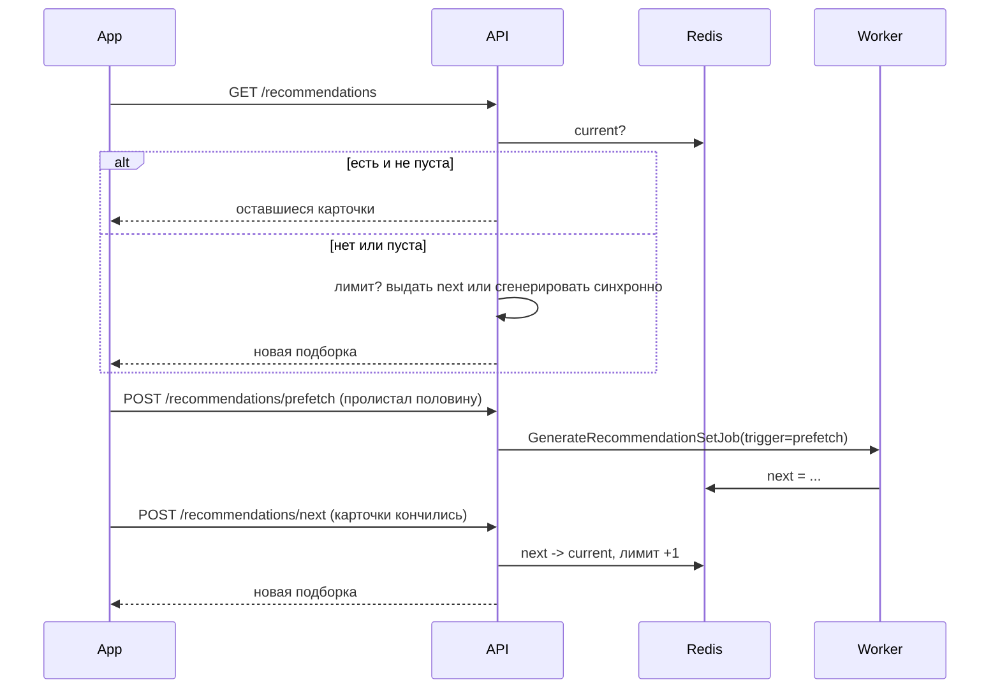

# F14. Рекомендации: генерация подборки, кэш, лимиты, настройки

Дата: 2026-11-19. Статус: к реализации. Идентификаторы кода — на английском, пояснения — на русском.

Связанные документы: [Roadmap](../roadmap/Roadmap.md), [F12 user_embeddings](../user_embeddings/User_embeddings.md),
[F15 recommendation_exploration](../recommendation_exploration/Recommendation_exploration.md), [F08 restrictions](../restrictions/Restrictions.md),
[F16 subscriptions](../subscriptions/Subscriptions.md) (права Free/Pro), [F13 onboarding](../onboarding/Onboarding.md),
[How_infrastructure_works](../../How_infrastructure_works.md) (пример 2), TZ.md 4.1.2.2, 4.1.2.3, 4.1.2.8, 4.3.5, 5.1.1,
5.7, 5.8, 6.2.2, 6.4.3, 7.1.4, 7.5 (лимиты Free/Pro).

Зависимости: F08, F10, F11, F12. F13 желательно (иначе нет холодного старта с онбордингом). F16 — для лимитов; до F16
используется временная реализация `EntitlementsContract` (раздел 7.3). F15 подключается позже через точку расширения
(раздел 5.7).

---

## 1. Цель

1. Отдавать пользователю подборку рекомендаций за ≤ 1–2 секунды (TZ 5.1.1), из кэша — за десятки миллисекунд.
2. Генерировать подборку по конвейеру TZ 6.4.3: кандидаты → жёсткая фильтрация → ранжирование → разнообразие →
   финальная выдача → кэш → лог.
3. Готовить следующую подборку заранее, когда пользователь пролистал половину текущей (TZ 6.4.3, шаг 1).
4. Лимиты: Free — 2 подборки в день по 3 карточки, Pro — до 30 подборок в день (TZ 7.5).
5. Настройки рекомендаций пользователя (TZ 7.1.4) и общие веса, которые меняет админ (TZ 4.1.2.8).
6. Просмотр рекомендаций пользователя админом без изменения кэша и без расхода лимита (TZ 4.1.2.3, 6.2.2).
7. Лог подборок: параметры, тайтлы, score, источники (TZ 6.4.3, шаг 8).

### 1.1. Не входит

- «Монетка» и пробирование — F15. Здесь — точка расширения и место в подборке.
- Реклама между карточками — клиент; бэкенд отдаёт флаг `ads_enabled` (F16).
- LLM-рекомендации — не используются.

---

## 2. Термины

| Термин | Значение |
| --- | --- |
| Подборка (set) | Сгенерированный упорядоченный список тайтлов с `set_id` |
| Текущая подборка | Та, что сейчас показывается пользователю (`current`) |
| Следующая подборка | Заранее сгенерированная, ещё не показанная (`next`) |
| Выдача подборки | Момент, когда `next` (или свежесгенерированная) становится `current`. **Только выдача расходует лимит** |
| Источник кандидата | Откуда тайтл попал в пул: `vector`, `similar_to_liked`, `popular`, `fresh`, `probe` (F15) |
| Холодный старт | У пользователя нет эмбеддинга (F12 вернул `null`) |

---

## 3. Модель данных

### 3.1. Настройки пользователя `user_recommendation_settings` (TZ 7.1.4)

| Колонка | Тип | Описание |
| --- | --- | --- |
| `user_id` | `bigint` PK, FK → `users.id`, `ON DELETE CASCADE` | |
| `preferred_genre_option_ids` | `jsonb` default `[]` | id `attribute_options` атрибута `genres` |
| `excluded_genre_option_ids` | `jsonb` default `[]` | жёсткое исключение |
| `preferred_mood_option_ids` | `jsonb` default `[]` | атрибут `moods` |
| `max_total_duration_minutes` | `integer` nullable | `duration × coalesce(episodes, 1)` тайтла ≤ значения |
| `allow_adult_content` | `boolean` default `false` | TZ `age_restriction`; используется F08 (`Viewer::adultContentAllowed`) |
| `weight_genre` | `decimal(4, 2)` nullable | переопределение глобального веса; `null` — брать глобальный |
| `weight_mood` | `decimal(4, 2)` nullable | |
| `weight_year` | `decimal(4, 2)` nullable | |
| `updated_at` | `timestamp` | |

Отличия от TZ 7.1.4 и почему:

- жанры — id опций, а не массивы русских строк: переименование значения в справочнике не ломает настройки;
- `preferred_time_of_day` не добавляется: в каталоге нет данных, с которыми его сопоставить (открытый вопрос 2);
- `age_restriction` переименован в `allow_adult_content`: из названия ясно, что `true` — разрешено.

Строка создаётся лениво при первом `PATCH`; при чтении отсутствующей строки — значения по умолчанию.

### 3.2. Лог подборок `recommendation_sets`

| Колонка | Тип | Описание |
| --- | --- | --- |
| `id` | `uuid` PK | `set_id` |
| `user_id` | `bigint` FK → `users.id`, `ON DELETE CASCADE` | |
| `trigger` | `string(16)` | `request`, `prefetch`, `precompute`, `admin_preview` |
| `algorithm_version` | `smallint` | `RecommendationPipeline::VERSION` |
| `is_cold_start` | `boolean` | |
| `params` | `jsonb` | веса, лимиты источников, число кандидатов по источникам и после фильтров, результат монетки F15, длительность этапов в мс |
| `items` | `jsonb` | `[{"title_id": 145, "position": 1, "score": 0.8123, "source": "vector", "components": {"similarity": 0.71, ...}}]` |
| `generated_at` | `timestamp` | |
| `served_at` | `timestamp` nullable | когда стала текущей |

Индексы: `(user_id, generated_at desc)`, `(generated_at)` для чистки.

Объём: 50 000 активных × ~3 подборки в день × ~1,5 КБ ≈ 225 МБ в день. Хранение — `config('recommendations.log_retention_days')`,
по умолчанию 14 дней (~3 ГБ). Команда `recommendations:prune-logs` ежедневно в 04:00 UTC удаляет старше, чанками по 10 000.

### 3.3. Redis

| Ключ | Тип | TTL | Назначение |
| --- | --- | --- | --- |
| `recommendations:user:{id}:current` | string (JSON) | динамический (3.4) | текущая подборка |
| `recommendations:user:{id}:next` | string (JSON) | динамический | следующая подборка |
| `recommendations:user:{id}:shown` | zset `title_id → unix time` | 14 дней | что показывалось; для исключения «недавно показанных» |
| `recommendations:user:{id}:quota:{YYYY-MM-DD}` | string (int) | 48 часов | сколько подборок выдано за локальный день |
| `recommendations:user:{id}:lock` | string | 30 секунд | защита от параллельной генерации |

JSON подборки: `{"set_id", "generated_at", "expires_at", "is_cold_start", "items": [{"title_id": 145, "source": "vector", "score": 0.81, "reason": {...}}]}`.
Только id тайтлов: карточки собираются при чтении (3.5), чтобы изменения тайтла и ограничения применялись сразу.

### 3.4. TTL подборки

| Пользователь | TTL | TZ |
| --- | --- | --- |
| Активный (`last_active_at` за 7 дней) | 12 часов | 6.4.3, шаг 2 (в TZ два значения — 12–24 и 6–8 часов, выбрано 12, Roadmap 5, п. 4) |
| Пассивный | 72 часа | 6.4.3 |

Значения — в настройках `recommendations.settings` (раздел 8).

### 3.5. Сборка ответа из кэша

При каждом чтении `current`:

1. Отбросить тайтлы, которые пользователь с момента генерации добавил в библиотеку (отсвайпал) — один запрос
   `user_titles WHERE title_id IN (...)`.
2. Отбросить тайтлы, не проходящие критерии видимости F08 (могли заблокировать).
3. Собрать карточки одним запросом (раздел 6.2).

Поэтому повторное открытие экрана показывает только непросвайпанные карточки.

---

## 4. Поток запросов клиента



---

## 5. Конвейер генерации

`App\Application\Recommendations\Services\RecommendationPipeline::generate(RecommendationRequest): GeneratedSet`.
Чистые правила (score, MMR, смешивание) — в Domain, SQL — в Infrastructure. Этапы и бюджет времени:

| Этап | Бюджет p95 |
| --- | --- |
| 1. Контекст | 30 мс |
| 2. Кандидаты | 300 мс |
| 3. Фильтрация | 50 мс |
| 4. Ранжирование | 100 мс |
| 5. Разнообразие | 150 мс |
| 6. Пробирование (F15) | 200 мс |
| 7. Запись | 50 мс |

### 5.1. Контекст

`RecommendationContext`: `userId`, `Viewer` (F08), `?Embedding userEmbedding` и `UserTasteProfile` (F12),
`UserRecommendationSettings`, `Entitlements` (F16), `RecommendationSettings` (глобальные, раздел 8),
`excludedTitleIds` (вся библиотека пользователя + `shown` за `shown_exclusion_days`), `likedTitleIds`
(просмотренные с оценкой ≥ 8, до 5 самых свежих), `preferredReleaseYear` (медиана `release_year` положительных
сигналов библиотеки или `null`), `now`.

### 5.2. Кандидаты (TZ 6.4.3, шаг 4)

Каждый источник — отдельный класс `CandidateSourceContract` в Infrastructure со своим лимитом. Все SQL-запросы источников
применяют общие жёсткие фильтры (5.3) **внутри** запроса, чтобы лимит не съедался отфильтрованными.

| Источник | Запрос | Лимит по умолчанию | При холодном старте |
| --- | --- | --- | --- |
| `vector` | `ORDER BY titles.embedding <=> :user_embedding` | 100 | нет |
| `similar_to_liked` | для каждого из `likedTitleIds`: `ORDER BY embedding <=> :liked_embedding` | 10 на тайтл | нет |
| `fresh` | `release_year >= текущий год − 1` или `status in (ongoing, announced)`, `ORDER BY provider_score_count DESC` | 20 | 40 |
| `popular` | `ORDER BY provider_score_count DESC NULLS LAST`, затем `provider_score DESC` | 30 | 110 |

TZ упоминает в кандидатах «набор тайтлов из "Буду смотреть", просмотренных и "Не интересно"» — они используются как
**исключения** и как опора `similar_to_liked`, а не как кандидаты: показывать уже добавленное бессмысленно.

Пул — объединение без дублей (≈ 150, TZ: «150 тайтлов»). Тайтл из нескольких источников получает **первый** по
приоритету: `similar_to_liked` > `vector` > `fresh` > `popular`; для `similar_to_liked` запоминается id тайтла-опоры.

`SET LOCAL hnsw.ef_search = 100` перед векторными запросами (F11, раздел 6). Векторные запросы — с
`embedding IS NOT NULL`.

### 5.3. Жёсткая фильтрация (TZ 6.4.3, шаг 5)

Исключаются:

1. тайтлы из библиотеки пользователя (все три списка);
2. не проходящие критерии видимости F08 (заблокированные, не по возрасту, 18+ без разрешения);
3. без постера (`poster_key IS NULL`) или без описания (`description_ru IS NULL AND description_en IS NULL`);
4. показанные за последние `shown_exclusion_days` (по умолчанию 3) — из Redis `shown`;
5. с жанром из `excluded_genre_option_ids`;
6. длиннее `max_total_duration_minutes`, если задано (тайтлы с неизвестной длительностью проходят);
7. мягко удалённые (F19).

Если после фильтров пул меньше `cards_per_set` — второй проход: снять фильтр 4 («недавно показанные»), затем расширить
лимит `popular` вдвое. Если и так пусто — подборка из того, что есть (возможно, пустая; клиент показывает «вы посмотрели
всё», `meta.exhausted = true`).

### 5.4. Ранжирование (TZ 6.4.3, шаг 6)

Доменный сервис `RecommendationScorer`. Для кандидата `t`, все компоненты в `[0, 1]`:

| Компонента | Формула |
| --- | --- |
| `similarity` | `max(0, cos(user_embedding, t.embedding))`; холодный старт — 0 |
| `genre` | доля жанров тайтла, входящих в `preferred_genre_option_ids`; нет предпочтений — 0 |
| `mood` | то же для `moods`; атрибут Shikimori пока не заполняет — компонента обычно 0 |
| `year` | `preferredReleaseYear = null` → 0; иначе `max(0, 1 − |t.year − preferred| / 30)` |
| `popularity` | `ln(1 + t.provider_score_count) / ln(1 + max_count_in_pool)` |
| `quality` | `coalesce(t.provider_score, 0) / 10` |
| `freshness` | `t.release_year ≥ текущий − 1` → 1; иначе `max(0, 1 − (текущий − t.release_year) / 10)` |

`score = Σ weight_k × component_k`. Веса — глобальные из настроек (раздел 8); `weight_genre`, `weight_mood`,
`weight_year` пользователя, если заданы, заменяют глобальные.

По умолчанию: `similarity 1.0`, `genre 1.0`, `mood 1.0`, `year 0.7` (TZ 7.1.4), `popularity 0.3`, `quality 0.3`,
`freshness 0.2`. При холодном старте `similarity` = 0, поэтому порядок задают популярность и качество.

Все компоненты кандидата сохраняются в лог (`components`).

### 5.5. Разнообразие (TZ 6.4.3, шаг 6)

MMR (maximal marginal relevance) по `mmr_pool` (60) лучшим по score:

```text
выбрано = []
пока |выбрано| < target:
    для каждого c из пула:  mmr(c) = λ · score(c) − (1 − λ) · max_{s ∈ выбрано} cos(c, s)
    взять c с максимальным mmr
```

`λ = 0.75` (настройка). Косинусы между кандидатами — в PHP по эмбеддингам пула (60 × 20 × 1536 умножений — допустимо).
Кандидаты без эмбеддинга (холодный старт, `popular` без эмбеддинга не бывают — эмбеддинг обязателен фильтром только для
векторных источников) получают `cos = 0` с остальными.

`target = cards_per_set` из прав пользователя: Free — 3, Pro — 20 (TZ: «топ-15–25»).

### 5.6. Причина рекомендации

Для UI — поле `reason` каждого элемента:

| source | reason |
| --- | --- |
| `similar_to_liked` | `{"type": "similar_to", "title": {"id": "...", "title": "Тетрадь смерти"}}` |
| `vector` | `{"type": "for_you"}` |
| `fresh` | `{"type": "new"}` |
| `popular` | `{"type": "popular"}` |
| `probe` | `{"type": "explore"}` |

### 5.7. Точка расширения для F15

После MMR вызывается `ExplorationMixerContract::mix(RecommendationContext, list<ScoredCandidate> $selected, int $target): MixResult`.
Реализация по умолчанию `NoExplorationMixer` возвращает подборку без изменений и `{"coin": null}` для лога. F15 подменяет
привязку. Контракт и пустая реализация — в этой фиче.

### 5.8. Запись

1. `recommendation_sets` (лог) — всегда, кроме исключений генерации.
2. Для `request`/`prefetch`/`precompute` — Redis (`current` или `next`), TTL по 3.4.
3. При выдаче (`served_at`) — `shown` (`ZADD` всех тайтлов подборки, затем `ZREMRANGEBYSCORE` старше 14 дней и
   `ZREMRANGEBYRANK`, чтобы хранить не больше 1000), `served_at` в лог.

---

## 6. HTTP API

Пути относительно `/api/v1`, группа `user`.

| Метод | Путь | Назначение |
| --- | --- | --- |
| GET | `/recommendations` | Текущая подборка (создаёт, если её нет) |
| POST | `/recommendations/prefetch` | Подготовить следующую в фоне |
| POST | `/recommendations/next` | Перейти к следующей подборке |
| GET | `/me/recommendation-settings` | Настройки рекомендаций |
| PATCH | `/me/recommendation-settings` | Изменить |

### 6.1. `GET /recommendations`

`GetRecommendationsHandler`:

1. Прочитать `current`, собрать карточки (3.5).
2. Если есть хотя бы одна карточка — вернуть.
3. Иначе — **выдать новую подборку** (6.4) и вернуть её.

### 6.2. Формат ответа

```json
{
  "data": {
    "set_id": "0193...",
    "generated_at": "2026-11-19T12:00:00Z",
    "expires_at": "2026-11-20T00:00:00Z",
    "items": [
      {
        "position": 1,
        "title": {
          "id": "0193...",
          "title": "Монолог фармацевта",
          "title_en": "The Apothecary Diaries",
          "type": "anime",
          "format": "tv",
          "release_year": 2023,
          "episodes": 24,
          "age_rating": 12,
          "short_description": "Девушка-фармацевт оказывается при дворе…",
          "genres": ["Драма", "Детектив", "Исторический"],
          "rating_average": 8.9,
          "images": { "poster": "https://...", "poster_thumb": "https://...", "banner": null }
        },
        "reason": { "type": "similar_to", "title": { "id": "...", "title": "Тетрадь смерти" } }
      }
    ]
  },
  "meta": {
    "remaining_in_set": 17,
    "next_ready": false,
    "exhausted": false,
    "is_cold_start": false,
    "quota": { "sets_used": 1, "sets_per_day": 30, "resets_at": "2026-11-19T21:00:00Z" },
    "ads_enabled": false
  }
}
```

- `short_description` — описание на языке пользователя, обрезанное до 300 символов по слову.
- `genres` — до 3 значений.
- `score` и `source` наружу **не** отдаются (только в админке).
- `resets_at` — ближайшая полночь в поясе пользователя, в UTC.
- Пагинации нет: подборка ≤ 20 элементов.

### 6.3. `POST /recommendations/prefetch`

Если `next` уже есть или генерация идёт (lock) — `202` без действий. Иначе поставить
`GenerateRecommendationSetJob(userId, trigger: prefetch, slot: next)` в очередь `recommendations`, `202`.
Лимит не расходуется: следующая подборка ещё не выдана. Лимитер `heavy` (F01).

Если лимит на сегодня уже исчерпан — `202` без постановки (готовить нечего), `meta.quota_exhausted = true`.

### 6.4. `POST /recommendations/next` и выдача подборки

`ServeNextSetHandler`, общий для `next` и шага 3 из 6.1:

1. Проверить лимит: `quota:{локальная дата}` < `sets_per_day`. Иначе `429 RECOMMENDATIONS_QUOTA_EXHAUSTED`,
   `details.resets_at`. Для `GET /recommendations` в этом случае — `200` с пустыми `items` и `meta.quota.exhausted = true`
   (экран должен открываться без ошибки).
2. Захватить `lock` (`SET NX EX 30`). Не удалось — подождать до 2 секунд (опрос раз в 200 мс), затем прочитать `current`.
3. Есть `next` → переложить в `current` (`RENAME` с новым TTL). Нет → сгенерировать синхронно (`trigger: request`) в `current`.
4. `INCR quota`, `EXPIRE 48h`; `served_at`; `shown`.
5. Отпустить lock.
6. Поставить `prefetch` следующей подборки в фоне — **нет**, только по запросу клиента (иначе расход ресурсов на
   пользователей, которые не листают дальше).

Системный предел Pro — 30 подборок в день (TZ 7.5: «системное ограничение 30, чтобы не положили воркер»).

### 6.5. Настройки рекомендаций

`GET /me/recommendation-settings`:

```json
{
  "data": {
    "preferred_genres": [ { "id": 15, "value": "Детектив" } ],
    "excluded_genres": [],
    "preferred_moods": [],
    "max_total_duration_minutes": null,
    "allow_adult_content": false
  }
}
```

`PATCH` — поля: `preferred_genre_option_ids[]`, `excluded_genre_option_ids[]`, `preferred_mood_option_ids[]`
(каждый ≤ 30 id существующих активных опций соответствующего атрибута), `max_total_duration_minutes` (30..100 000 или `null`),
`allow_adult_content`.

- `allow_adult_content = true` для пользователя < 18 → `422 RECOMMENDATIONS_ADULT_CONTENT_NOT_ALLOWED`.
- Пересечение `preferred` и `excluded` → 422.
- После сохранения — удалить `next` (готовилась по старым настройкам); `current` не трогать.
- Событие `RecommendationSettingsChanged(userId)` — F08 учитывает `allow_adult_content` в `Viewer`.

Веса `weight_*` через пользовательский API не меняются (только админ, раздел 9).

---

## 7. Фоновая работа и инвалидация

### 7.1. `GenerateRecommendationSetJob`

Очередь `recommendations`, `ShouldBeUnique` по `userId + slot` на 120 секунд, `tries = 2`, `timeout = 30`.
Вызывает конвейер и пишет в указанный слот. Если слот уже занят свежей подборкой — ничего не делает.

### 7.2. Подписки на события

| Событие | Действие |
| --- | --- |
| `UserEmbeddingUpdated` (F12) | удалить `next`; поставить `GenerateRecommendationSetJob(slot: next, trigger: precompute)` — TZ 6.4.3: «запуск обновления эмбеддинга и генерации нового набора» |
| `OnboardingCompleted` (F13) | удалить `current` и `next`: первая персональная подборка должна появиться сразу. **Лимит при этом не расходуется** — следующая выдача в тот же день для Free за счёт онбординга бесплатна (флаг `free_serve_after_onboarding` в Redis на 1 час) |
| `UserLoggedOut` (F03) | удалить `current` и `next` (TZ 6.1.1, сценарий 4). `shown` и `quota` не трогать — иначе logout обходит лимит |
| `RecommendationSettingsChanged` | удалить `next` |
| `SubscriptionChanged` (F16) | удалить `next` (изменился размер подборки) |
| `LibraryEntryChanged` (F10) | ничего: отсвайпанное отфильтруется при чтении (3.5) |

### 7.3. Права до F16

`EntitlementsContract::forUser(int $userId): Entitlements` — объявляется в F16. Если F14 делается раньше, эта фича
создаёт контракт и временную реализацию `ConfigEntitlements`, возвращающую значения из
`config('recommendations.default_entitlements')` (по умолчанию Free: 2 подборки по 3 карточки, `ads_enabled = true`).
F16 подменяет привязку.

---

## 8. Глобальные настройки (админ, TZ 4.1.2.8)

Ключ `system_settings` — `recommendations.settings`. По умолчанию — `config/recommendations.php`.

```json
{
  "weights": {
    "similarity": 1.0, "genre": 1.0, "mood": 1.0, "year": 0.7,
    "popularity": 0.3, "quality": 0.3, "freshness": 0.2
  },
  "sources": {
    "vector": 100, "similar_to_liked": 10, "similar_to_liked_anchors": 5,
    "fresh": 20, "popular": 30, "cold_start_fresh": 40, "cold_start_popular": 110
  },
  "mmr_lambda": 0.75,
  "mmr_pool": 60,
  "shown_exclusion_days": 3,
  "ttl_active_hours": 12,
  "ttl_passive_hours": 72,
  "liked_rating_threshold": 8
}
```

Валидация `RecommendationSettings`: веса 0..5, лимиты источников 0..500, `mmr_lambda` 0..1, `mmr_pool` ≥ 20, TTL 1..168.

---

## 9. Админские эндпоинты

`/api/v1/admin`. Чтение — `admin`, `moderator`; изменение глобальных настроек — только `admin`. Изменения — аудит.

| Метод | Путь | Назначение |
| --- | --- | --- |
| GET | `/recommendations/settings` | Глобальные настройки |
| PUT | `/recommendations/settings` | Заменить |
| GET | `/users/{id}/recommendations` | Что пользователь видит сейчас (TZ 6.2.2) |
| POST | `/users/{id}/recommendations/preview` | Сгенерировать «как для пользователя» без побочных эффектов |
| GET | `/users/{id}/recommendation-settings` | Настройки пользователя, включая `weight_*` (TZ 4.1.2.2) |
| PATCH | `/users/{id}/recommendation-settings` | Изменить `weight_*` пользователя (`null` — сбросить к глобальным) |
| GET | `/users/{id}/recommendation-sets?limit&offset` | Лог подборок пользователя |

### 9.1. `GET /users/{id}/recommendations`

Читает `current` и `next` **без** изменений (без фильтрации отсвайпанных и без записи в `shown`). Элементы — с `score`,
`source`, `components`, `reason` и флагом `still_visible` (проходит ли сейчас фильтры 3.5).
Нет `current` — `data.current = null`.

### 9.2. `POST /users/{id}/recommendations/preview`

TZ 4.1.2.3: «без обновления кэша, чтобы админ не тратил попытки пользователя». Конвейер с `trigger = admin_preview`:

- контекст строится от лица пользователя (его `Viewer`, а не админа);
- не пишет `current`/`next`, не меняет `quota` и `shown`;
- пишет лог `recommendation_sets` (для отладки), `served_at = null`;
- тело (необязательно): `weights` — временное переопределение весов для эксперимента (не сохраняется).

Ответ — как 9.1 плюс `params` (число кандидатов по источникам, после фильтров, время этапов).

---

## 10. Наблюдаемость и производительность

- Лог `info` на каждую генерацию: `user_id`, `trigger`, `candidates`, `after_filters`, `duration_ms`, `is_cold_start`.
- Генерация дольше 1500 мс — `warning` с длительностью этапов.
- Нагрузочный тест (группа `slow`, `pgsql`): 25 000 тайтлов с фейковыми эмбеддингами, пользователь со 100 сигналами —
  p95 генерации ≤ 1500 мс, чтение из кэша ≤ 100 мс.

---

## 11. Слои

```text
app/Domain/Recommendations/
├─ DTOs/RecommendationContext.php, Candidate.php, ScoredCandidate.php, GeneratedSet.php
├─ Enums/CandidateSource.php, RecommendationTrigger.php, RecommendationSlot.php
├─ ValueObjects/RecommendationSettings.php, RecommendationWeights.php, UserRecommendationSettings.php
├─ Services/RecommendationScorer.php
├─ Services/MaximalMarginalRelevance.php
├─ Services/QuotaPolicy.php
└─ Contracts/ExplorationMixerContract.php
app/Application/Recommendations/
├─ Contracts/CandidateSourceContract.php, RecommendationCacheContract.php, RecommendationLogContract.php,
│            RecommendationCardReaderContract.php, UserRecommendationSettingsRepositoryContract.php, EntitlementsContract.php*
├─ Services/RecommendationPipeline.php, RecommendationContextFactory.php, NoExplorationMixer.php
├─ UseCases/GetRecommendationsHandler.php, ServeNextSetHandler.php, PrefetchRecommendationsHandler.php,
│           GetMySettingsHandler.php, UpdateMySettingsHandler.php, Admin/*
├─ Jobs/GenerateRecommendationSetJob.php
└─ Listeners/*
app/Infrastructure/Recommendations/
├─ Sources/VectorCandidateSource.php, SimilarToLikedCandidateSource.php, FreshCandidateSource.php, PopularCandidateSource.php
├─ RedisRecommendationCache.php
└─ EloquentRecommendationLog.php
app/Interfaces/Http/Controllers/Recommendations/*, Controllers/Admin/Recommendations/*
config/recommendations.php
```

`*` — если F16 ещё не сделана.

---

## 12. Коды ошибок

| HTTP | code | Когда |
| --- | --- | --- |
| 429 | `RECOMMENDATIONS_QUOTA_EXHAUSTED` | Лимит подборок на сегодня; `details.resets_at` |
| 422 | `RECOMMENDATIONS_ADULT_CONTENT_NOT_ALLOWED` | 18+ для несовершеннолетнего |
| 422 | `VALIDATION_FAILED` | Неизвестные опции, пересечение предпочтений и исключений |
| 503 | `RECOMMENDATIONS_UNAVAILABLE` | Генерация упала, а кэша нет (БД недоступна); клиент показывает офлайн-кэш (TZ 5.1.3) |

---

## 13. Обязательные тесты

Unit (Domain):

1. `RecommendationScorer`: каждая компонента на граничных значениях; пользовательский `weight_genre` заменяет глобальный;
   холодный старт → `similarity = 0`.
2. `MaximalMarginalRelevance`: при `λ = 1` — порядок по score; при `λ = 0.5` два почти одинаковых тайтла не идут подряд.
3. `QuotaPolicy`: локальная дата пользователя `Asia/Vladivostok` в 23:30 UTC — уже следующий день.

Feature (фейковый провайдер эмбеддингов F11, фикстуры каталога 300 тайтлов, группа `pgsql` для векторных источников):

4. Первый `GET /recommendations` у Pro-пользователя → 20 карточек, лимит `sets_used = 1`, лог записан с `served_at`.
5. Повторный `GET` → та же подборка, лимит не изменился.
6. Тайтл, добавленный в «Не интересно», при следующем `GET` исчезает; `remaining_in_set` уменьшается.
7. Free: 3 карточки; третья выдача за день → `POST /next` = 429, `GET` = 200 с пустыми `items` и `quota.exhausted`.
8. В подборке нет: тайтлов из библиотеки, заблокированных, 18+ у несовершеннолетнего, без постера, с исключённым жанром,
   показанных за 3 дня.
9. Prefetch: `next` готовится в фоне (`Queue::fake` → выполнить job), `POST /next` берёт её без генерации, лимит +1.
10. Холодный старт: пользователь без эмбеддинга получает подборку из `popular`/`fresh`, `is_cold_start = true`.
11. `UserLoggedOut` удаляет `current` и `next`, но не `quota`: после повторного входа лимит прежний.
12. `UserEmbeddingUpdated` → `next` удалена и поставлена job.
13. Админ `GET /admin/users/{id}/recommendations` не меняет `quota`, `shown`, `current`; `preview` пишет лог с
    `trigger = admin_preview` и не трогает Redis-ключи пользователя.
14. `PATCH /me/recommendation-settings` с `allow_adult_content = true` для 16-летнего → 422; пересечение → 422.
15. `PUT /admin/recommendations/settings` с `mmr_lambda = 2` → 422; от `moderator` → 403.
16. Параллельные `POST /next` (два запроса) → лимит +1, а не +2 (lock).
17. `recommendations:prune-logs` удаляет записи старше срока.

---

## 14. Критерии приёмки

- Подборка из кэша — p95 ≤ 100 мс; генерация — p95 ≤ 1500 мс на 25 000 тайтлов.
- Лимиты Free/Pro соблюдаются, logout и онбординг не дают обойти лимит сверх описанного.
- Админ видит рекомендации пользователя с причинами и компонентами score, не влияя на пользователя.

---

## 15. План реализации

1. Миграции настроек и лога, конфиг, `RecommendationSettings`.
2. Домен: scorer, MMR, квоты.
3. Источники кандидатов и фильтры (SQL), конвейер с `NoExplorationMixer`.
4. Redis-кэш, выдача, prefetch, lock.
5. Пользовательские эндпоинты, сборка карточек.
6. Настройки пользователя.
7. Подписки на события, job.
8. Админские эндпоинты, чистка лога, нагрузочный тест.

---

## 16. Открытые вопросы

1. **Атрибут `moods` пуст.** Shikimori не отдаёт настроения, поэтому вес `mood` сейчас ни на что не влияет. Источник
   настроений (ручная разметка, генерация LLM по описанию, другой поставщик) — отдельное решение.
2. **`preferred_time_of_day` из TZ 7.1.4** не реализован: непонятно, с чем его сопоставлять (длительность? настроение?).
   Нужна продуктовая формулировка.
3. **Бесплатная выдача после онбординга для Free.** Предложено не списывать лимит за первую подборку после онбординга,
   иначе Free-пользователь, прошедший онбординг вечером, получит 3 карточки и почти сразу упрётся в лимит. Подтвердить.
