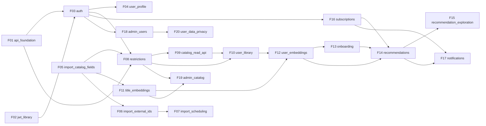

# Дорожная карта оставшегося функционала

Дата: 2026-11-19. Идентификаторы кода — на английском, пояснения — на русском.

Этот документ — точка входа для всех ТЗ в `docs/tasks/<имя_фичи>/`. Он фиксирует:

1. что уже сделано и что осталось;
2. на какие самостоятельные фичи разбит остаток и в каком порядке их делать;
3. сквозные решения, общие для всех ТЗ;
4. противоречия, найденные в [docs/TZ.md](../../TZ.md), и выбранное решение по каждому.

**Перед реализацией любой фичи исполнитель обязан прочитать:**

1. этот документ целиком;
2. [docs/Development_conventions.md](../../Development_conventions.md) — стиль кода, Git flow, запрет комментариев;
3. [docs/How_infrastructure_works.md](../../How_infrastructure_works.md) — слои, инварианты и политики, репозитории;
4. [api_foundation](../api_foundation/Api_foundation.md) — формат API, ошибки, пагинация, общие компоненты;
5. ТЗ своей фичи и все ТЗ, перечисленные в его разделе «Зависимости».

---

## 1. Что уже сделано

| Область | Состояние | Где описано |
| --- | --- | --- |
| Каркас слоёв `Domain / Application / Infrastructure / Interfaces` | готов | README, How_infrastructure_works |
| Импорт от поставщиков: клиенты Shikimori (API + дамп), фильтрация, нормализация, оркестратор с checkpoint и resume, lock прогона | готов | `docs/tasks/filter_data_from_providers/*` |
| Упаковщик каталога и `CatalogBulkWriter` (titles, attribute_definitions, attribute_options, title_attributes) | готов | `docs/tasks/catalog_data_packer`, `docs/tasks/catalog_candidate_sink` |
| Сохраняющий sink, защита ручных описаний и `is_incomplete`, `last_synced_at` | готов | `docs/tasks/catalog_candidate_sink` |
| Обработка изображений: скачивание с защитой от SSRF, сжатие (GD, webp), S3, `IngestTitleImagesJob` | готов, но **не подключён** к импорту | `docs/tasks/image_compression` |
| Связка импорта с картинками через transactional outbox | **спроектировано, не реализовано** | `docs/tasks/import_images_outbox` |
| Доменная модель пользователя: `User`, `UserPreference`, VO, политики, `EloquentUserRepository` | готов | How_infrastructure_works, раздел «Репозиторий пользователей» |

Чего нет совсем: HTTP API (`routes/api.php` отсутствует), авторизации, библиотеки пользователя,
эмбеддингов, рекомендаций, онбординга, ограничений, подписок, уведомлений, админки, расписания.

---

## 2. Декомпозиция на фичи

Каждая фича — отдельная папка `docs/tasks/<имя_фичи>/` с ТЗ. Фича — самостоятельный кусок
функционала, который можно реализовать, протестировать и влить отдельной веткой.

| № | Папка | Что делает | Разделы TZ.md |
| --- | --- | --- | --- |
| F01 | [api_foundation](../api_foundation/Api_foundation.md) | `routes/api.php`, формат ответов и ошибок, пагинация, request id, rate limiting, `TransactionRunner`, `SystemSettings`, `AdminAuditLog`, очереди, планировщик | 5.1, 5.4.5 |
| F02 | [jwt_library](../jwt_library/Jwt_library.md) | **Отдельный репозиторий и composer-пакет.** Подпись и проверка JWT, пара access/refresh, ротация, отзыв | 6.1.1 |
| F03 | [auth](../auth/Auth.md) | Регистрация, вход, бан после 5 попыток, refresh, logout, секретная фраза, сброс пароля, сессии устройств, middleware ролей | 4.1.1.1, 4.1.1.13, 6.1.1, 6.1.13, 7.3.2 (новая сессия — событие) |
| F04 | [user_profile](../user_profile/User_profile.md) | Профиль, статистика, настройки, редактирование, смена пароля и email, аватар | 4.1.1.2–4.1.1.4, 6.1.2–6.1.4 |
| F05 | [import_catalog_fields](../import_catalog_fields/Import_catalog_fields.md) | Недостающие поля каталога из импорта: возрастной рейтинг, число эпизодов, формат, рейтинг поставщика, популярность | 6.3.2, 6.4.2, 7.1.2 |
| F06 | [import_external_ids](../import_external_ids/Import_external_ids.md) | Таблица `external_ids`, разрешение идентичности тайтла, коллизии как отказы, ручные исключения из импорта | 6.3.2, 6.3.3 |
| F07 | [import_scheduling](../import_scheduling/Import_scheduling.md) | Ежедневный импорт по расписанию, ручной запуск админом, импорт одного тайтла, просмотр прогонов и отказов | 6.3.1, 6.3.2 (сценарии 1–2) |
| F08 | [restrictions](../restrictions/Restrictions.md) | Движок правил, блокировка тайтла, возрастное ограничение, фоновая чистка списков пользователей | 6.2.7, 7.1.12, 7.4 |
| F09 | [catalog_read_api](../catalog_read_api/Catalog_read_api.md) | Карточка тайтла, поиск по локальной базе, ссылки на изображения | 4.1.1.14, 6.1.14 |
| F10 | [user_library](../user_library/User_library.md) | Просмотренные, оценки с блокировкой на 4 часа, «Буду смотреть», «Не интересно», переносы, массовое удаление, счётчики | 4.1.1.5–4.1.1.12, 6.1.5–6.1.12 |
| F11 | [title_embeddings](../title_embeddings/Title_embeddings.md) | Генерация эмбеддингов тайтлов через OpenAI `text-embedding-3-small` | 6.3.2, 7.7 |
| F12 | [user_embeddings](../user_embeddings/User_embeddings.md) | Счётчик действий, pending, планировщик, расчёт эмбеддинга пользователя | 6.4.3 (счётчик и обновление эмбеддинга) |
| F13 | [onboarding](../onboarding/Onboarding.md) | Упрощённое входное игровое тестирование, параметры для админа | 4.1.2.9, 4.3.1, 6.4.1 |
| F14 | [recommendations](../recommendations/Recommendations.md) | Генерация подборки, кэш, лимиты Free/Pro, лог показов, настройки рекомендаций, просмотр админом | 4.1.2.2, 4.1.2.3, 4.1.2.8, 4.3.5, 6.2.2, 6.4.3, 7.1.4 |
| F15 | [recommendation_exploration](../recommendation_exploration/Recommendation_exploration.md) | «Монетка» и пробирование предпочтений, персонализация вероятности | 4.3.2–4.3.4, 6.4.2, 6.4.3 (пробирование) |
| F16 | [subscriptions](../subscriptions/Subscriptions.md) | Планы, оформление, отмена, автопродление, истечение, логи, права Free/Pro, продление админом. Шлюз — за контрактом, реальный провайдер не выбран | 4.1.1.15–4.1.1.18, 4.1.2.10, 6.1.15–6.1.18, 7.1.10, 7.1.11, 7.5 |
| F17 | [notifications](../notifications/Notifications.md) | Внутренние уведомления (колокольчик), push-токены, рассылки по расписанию. Push-провайдер — за контрактом | 5.5.4, 7.3 |
| F18 | [admin_users](../admin_users/Admin_users.md) | Список и карточка пользователя, смена роли и статуса, удаление | 4.1.2.1, 4.1.2.6, 4.1.2.7, 6.2.1, 6.2.5, 6.2.6 |
| F19 | [admin_catalog](../admin_catalog/Admin_catalog.md) | Каталог для админа, создание, редактирование, удаление тайтлов, ручной постер | 4.1.2.4, 4.1.2.5, 6.2.3, 6.2.4 |
| F20 | [user_data_privacy](../user_data_privacy/User_data_privacy.md) | Удаление аккаунта пользователем, отложенная очистка данных, экспорт списков JSON/PDF | 5.4.1, 5.4.3, 5.4.4, 5.6.3 |

Уже существующее и **не входящее** в эти ТЗ: [import_images_outbox](../import_images_outbox/Import_images_outbox.md) — у
него своё готовое ТЗ.

### 2.1. Что не покрыто ни одним ТЗ

| Пункт TZ.md | Почему |
| --- | --- |
| 5.2 UX, свайпы, тема, адаптив | Задача мобильного клиента. Бэкенд только отдаёт данные и настройки |
| 5.1.3 Работа оффлайн | Задача клиента: кэш карточек и рекомендаций на устройстве |
| 5.3.3 Резервное копирование, 5.5.5 мониторинг Yandex Cloud | Инфраструктура и эксплуатация, не код монолита |
| 5.6.2 Реклама в бесплатной версии | Бэкенд отдаёт только флаг `ads_enabled` (F16) |
| OAuth2 (Яндекс, VK) | После MVP. В F03 заложена точка расширения |
| Вариант онбординга «Собери свой сезон» и «Рулетка» | Решение: в MVP только упрощённый вариант (F13) |
| Push «новые сезоны» | Нужны данные о сезонах и франшизах, которых в каталоге нет. Отложено, см. F17 |

---

## 3. Порядок реализации и зависимости

Рекомендуемые этапы. Внутри этапа фичи независимы и могут идти параллельно разными ветками.

| Этап | Фичи | Результат этапа |
| --- | --- | --- |
| 0 | F01, F02 | Каркас API и библиотека токенов |
| 1 | F03, F05, import_images_outbox | Можно зарегистрироваться и войти; каталог содержит возраст, эпизоды, популярность и постеры |
| 2 | F04, F08, F06 | Профиль; ограничения; надёжная идентичность тайтлов |
| 3 | F09, F07, F11 | Карточки и поиск; импорт по расписанию; эмбеддинги тайтлов |
| 4 | F10, F16 | Библиотека пользователя; подписки |
| 5 | F12, F13 | Эмбеддинг пользователя; онбординг |
| 6 | F14, F18, F19 | Рекомендации; админка |
| 7 | F15, F17, F20 | Монетка и пробирование; уведомления; приватность |

F16 нужна F14 только ради лимитов Free/Pro. Если F14 делается раньше F16, F14 использует
временную реализацию `EntitlementsContract`, которая всем возвращает Free (см. F14, раздел «Зависимости»).

---

## 4. Сквозные решения (обязательны для всех ТЗ)

### 4.1. Решения, принятые с заказчиком 2026-11-19

| Тема | Решение |
| --- | --- |
| Токены | Своя библиотека отдельным пакетом в отдельном репозитории (F02). Готовые пакеты Laravel для авторизации (Sanctum, Passport) не используются. Access — JWT, refresh — opaque-строка с ротацией |
| Готовые пакеты Laravel | Не используются: Sanctum, Passport, Cashier, Filament, spatie/* и аналоги. Встроенные возможности самого фреймворка (HTTP-клиент, очереди, Redis, `RateLimiter`, события, валидация, `Storage`, шифрование) использовать **можно** |
| Эмбеддинги | Внешний API OpenAI, модель `text-embedding-3-small`, размерность 1536 (совпадает с колонками `vector(1536)`) |
| Платёжный шлюз | Не выбран. Делается контракт `PaymentGatewayContract` и фейковая реализация. Реальный шлюз — отдельная задача после выбора |
| Push-провайдер | Не выбран. Делается контракт `PushSenderContract` и реализация, пишущая в лог. Внутренние уведомления (колокольчик) делаются полностью |
| Онбординг | Упрощённый вариант: жанры → карточки → «один из четырёх» → проверка достаточности |
| Библиотека пользователя | Одна таблица `user_titles` с полем `list` (`watched`, `planned`, `not_interested`) и уникальностью `(user_id, title_id)` |
| Админка | JSON API под `/api/v1/admin/*`, фронт админки — отдельный проект |
| Расположение ТЗ | `docs/tasks/<имя_фичи>/` |

### 4.2. Слои и размещение кода

Правила из How_infrastructure_works обязательны. Краткая выжимка для исполнителя:

- `Domain/<Context>` — сущности, VO, enum, политики `*Policy`, доменные сервисы, интерфейсы
  репозиториев `Domain/<Context>/Repositories/<Name>Repository.php` (как `UserRepository`), доменные
  исключения. **Никаких** фасадов, моделей Eloquent, `Request`, `Cache`, `DB`, `Http`, `Carbon`-фасадов.
  Время передаётся параметром `DateTimeImmutable` или через `ClockContract` (см. F01).
- `Application/<Context>` — use case (`UseCases/<Verb><Noun>Handler.php`), команды и запросы
  (`Commands/*Command.php`, `Queries/*Query.php`), DTO (`DTOs/*`), порты к внешнему миру
  (`Contracts/<Name>Contract.php`, как `TitleRepositoryContract`), jobs (`Jobs/*Job.php`), события
  (`Events/*`).
- `Infrastructure` — Eloquent-модели (`Persistence/Eloquent/Models/<Context>/*`), репозитории
  (`Persistence/Eloquent/Repositories/<Context>/Eloquent*Repository.php`), Redis
  (`Infrastructure/Cache/<Context>/*` или `Infrastructure/<Context>/Redis*`), внешние API, service providers.
- `Interfaces/Http` — контроллеры (`Controllers/<Context>/*Controller.php`, один публичный метод
  `__invoke`), запросы (`Requests/<Context>/*Request.php`), ресурсы (`Resources/<Context>/*Resource.php`),
  middleware. `Interfaces/Console/Commands` — artisan-команды.
- Use case не трогает Eloquent напрямую, контроллер не трогает репозитории напрямую.
- Привязки контрактов к реализациям — в service provider своего контекста
  `app/Infrastructure/ServiceProviders/<Context>ServiceProvider.php`, зарегистрированном в
  `bootstrap/providers.php`. Для существующих контекстов допустимо дописать `AppServiceProvider`.

### 4.3. Стиль кода

- `declare(strict_types=1);` в каждом новом PHP-файле.
- Классы по умолчанию `final`; DTO, VO, команды — `final readonly`.
- Правила 1 и 2 Development_conventions: две пустые строки между группами членов класса,
  выравнивание параметров в многострочных сигнатурах колонками.
- **Комментарии и PHPDoc в коде не пишутся** (правило 4). Исключение — `@return list<...>` и
  `@param` с generic-типами массивов там, где без них теряется тип (так уже сделано в проекте).
- Константы имён таблиц и колонок — в Eloquent-модели: `TABLE_NAME`, `FIELD_*` (как в `User`, `Title`).
  В репозиториях и запросах обращаться к колонкам только через эти константы.
- После правок: `vendor/bin/pint <изменённые файлы>`, затем `vendor/bin/pint --test <файлы>`.

### 4.4. Идентификаторы во внешнем API

- Тайтл наружу идентифицируется **только** `titles.uuid`. Числовой `titles.id` в API не выдаётся.
  Во всех ТЗ поле `title_id` в запросах и ответах — это UUID тайтла.
- Пользователь наружу идентифицируется числовым `users.id` (только в админке; обычный пользователь
  свой id видит в профиле).
- Внутри БД все внешние ключи на тайтл — `titles.id` (bigint).

### 4.5. Время

- В БД — `timestamp` без пояса, значения в UTC (`APP_TIMEZONE=UTC` проверить в `config/app.php`).
- В API — ISO 8601 с суффиксом `Z`: `2026-11-19T15:04:05Z`. Даты без времени — `YYYY-MM-DD`.
- «Сегодня» и «день» для пользователя (лимиты подборок, окно уведомлений 18:00–20:00) считаются в
  часовом поясе пользователя из `user_preferences.timezone`.

### 4.6. Очереди Horizon

| Очередь | Супервизор | Что в ней | Фича |
| --- | --- | --- | --- |
| `default` | supervisor-1 (есть) | прочее | — |
| `images` | supervisor-2 (есть) | картинки | outbox, F04, F19 |
| `embeddings` | supervisor-3 (новый, 1 процесс) | эмбеддинги тайтлов | F11 |
| `recommendations` | supervisor-4 (новый, 2 процесса) | эмбеддинг пользователя, предрасчёт подборок, чистка после блокировки | F12, F14, F08 |
| `notifications` | supervisor-5 (новый, 1 процесс) | отправка уведомлений | F17 |
| `billing` | supervisor-6 (новый, 1 процесс) | списания, обработка вебхуков | F16 |

Новый супервизор добавляет та фича, которая первой использует очередь. Параметры по образцу
supervisor-2 в `config/horizon.php` (`memory`, `timeout`, `tries`, `maxProcesses` для local и production).
`timeout` должен быть меньше `REDIS_QUEUE_RETRY_AFTER` (240).

### 4.7. Планировщик

Планировщик Laravel подключается в `bootstrap/app.php` через `withSchedule(...)`. Если
import_images_outbox уже реализован, расписание там уже есть — дописывать в него. Если нет — первая фича,
которой нужно расписание, подключает `withSchedule` сама. Все задачи расписания:

- запускают artisan-команду или job, а не замыкание;
- имеют `->withoutOverlapping()` и `->onOneServer()`;
- логируют старт и итог одной строкой в канал `stack`.

Сводный список задач расписания всех фич — в разделе 6.

### 4.8. Тесты

- По умолчанию тесты идут на SQLite в памяти (`phpunit.xml`).
- Тесты, которым нужен PostgreSQL (pgvector, `citext`, `pg_trgm`, `FOR UPDATE`, частичные индексы, `jsonb`-операторы),
  помечаются `#[Group('pgsql')]` и используют подключение `pgsql_testing` и трейт
  `tests/Support/UsesIsolatedPostgresSchema.php`.
- Unit-тесты домена — `tests/Unit/Domain/<Context>/...`, application — `tests/Unit/Application/<Context>/...`,
  feature-тесты HTTP — `tests/Feature/Http/<Context>/...`, тесты репозиториев — `tests/Feature/<Context>/...`.
- Каждое ТЗ содержит раздел «Обязательные тесты». Набор минимальный: исполнитель может добавить больше,
  но не меньше.
- Внешние сервисы (OpenAI, платёжный шлюз, push) в тестах **никогда** не вызываются по сети:
  только фейковые реализации контрактов или `Http::fake()`.
- Запуск: `docker compose exec app php artisan test`, PostgreSQL-группа:
  `docker compose exec app php artisan test --group=pgsql`.

### 4.9. Git

- Ветка — первые 7 символов хеша задачи в Notion (Development_conventions, 3.1).
- Коммиты на английском, PR `<ветка>.<название задачи>`, в описании PR — ссылка на Notion.
- Одна фича из этого документа = одна или несколько задач в Notion. Крупные фичи (F14, F16) лучше
  резать по этапам из раздела «План реализации» их ТЗ.

### 4.10. Логи и персональные данные

- В логах не пишутся: пароли, секретные фразы, токены (access, refresh, reset), push-токены, хеши,
  полные email. Email в логах маскируется: `a***@gmail.com`.
- В лог пишется `user_id`, а не email или ник.
- Сообщения логов — на английском, в контекст — массив с ключами `snake_case`.

---

## 5. Противоречия в TZ.md и принятые решения

| № | Где | Противоречие | Решение |
| --- | --- | --- | --- |
| 1 | 6.1.10, сценарий 1 | «Не интересно» пишется в `user_watchlist` со статусом `planned` | Таблица `user_titles`, `list = not_interested` (F10) |
| 2 | 6.1.11 | Перенос в «Не интересно» создаёт запись со статусом `dropped` | Перенос меняет `list` существующей строки на `not_interested` (F10) |
| 3 | 6.4.3 (код) и 7.1.3 | Есть `user_watch_history`, `user_watchlist` и `user_blocked_titles` | Всё в `user_titles` (F10) |
| 4 | 6.4.3, шаги 2 и 7 | TTL кэша рекомендаций для активного: «12–24 часа» и «6–8 часов» | 12 часов для активного, 72 часа для пассивного, оба значения в настройках (F14) |
| 5 | 6.4.3, счётчик | Ключ `recomendation:user:{user_id}:action_to_refresh:{count}` содержит значение в имени | Ключ `recommendations:user:{user_id}:actions_to_refresh`, значение — число (F12) |
| 6 | 6.4.3, счётчик | `user_embedding_pending:{user_id}` — ключ на пользователя, планировщику придётся сканировать Redis | Одно Redis-множество `recommendations:embedding_pending` с id пользователей (F12) |
| 7 | 7.5, сценарий 1 | При оплате «обновляется роль пользователя (is_premium = true)» | Роль не меняется. Права Free/Pro вычисляются из подписки (F16) |
| 8 | 7.5, сценарий 2 и 6.1.17 | Списание «за 1–3 дня до конца» и «когда истекла» | Первая попытка за 24 часа до конца периода, повторы в льготный период (F16) |
| 9 | 7.1.2 и 6.3.3 | `external_id` колонкой в `titles` и отдельная таблица `external_ids` | Отдельная таблица `external_ids` (F06) |
| 10 | 7.4 | `handler_class` правила хранится в БД и инстанцируется по имени | Класс правила задаётся в коде по `code`; БД только включает, выключает и задаёт приоритет (F08) |
| 11 | 6.4.3, код пробирования | Окно сходства `[0.60; 0.62)` слишком узкое для реальных эмбеддингов | Пороги в настройках, команда калибровки (F15) |
| 12 | 6.1.6 | Для сериалов «количество серий», но в каталоге нет числа эпизодов | Поле `episodes` в `titles` (F05) |
| 13 | 7.1.2 и миграция | `titles.rating_avg` — `decimal(3, 2)`, максимум 9.99, а средняя оценка может быть 10 | Миграция на `decimal(4, 2)` + колонка `rating_sum` (F10) |
| 14 | 6.2.4, 6.3.3 | Модель `Title` объявляет `FIELD_DELETED_AT`, но колонки `deleted_at` в `titles` нет | Колонку добавляет F19 |
| 15 | 6.1.8, сценарий 3 | Удаление записи о просмотре блокируется, если оценка заблокирована на 4 часа | Реализуется как в ТЗ, см. открытый вопрос в F10 |
| 16 | 6.1.1, сценарий 1 | «email или логин и пароль» при регистрации, но в схеме обязательны и ник, и email | При регистрации обязательны оба; вход — по email **или** нику (F03) |

---

## 6. Сводная таблица фоновых задач

| Команда / job | Расписание | Фича |
| --- | --- | --- |
| `media:publish-image-ingestions` | каждую минуту | import_images_outbox |
| `import:scheduled-run` | ежедневно 03:00 UTC | F07 |
| `catalog:dispatch-title-embeddings` | каждые 5 минут | F11 |
| `recommendations:process-embedding-pending` | каждые 5 минут | F12 |
| `recommendations:refresh-stale-embeddings` | каждый час | F12 |
| `recommendations:prune-logs` | ежедневно 04:00 UTC | F14 |
| `billing:renew-subscriptions` | каждый час | F16 |
| `billing:expire-subscriptions` | каждый час | F16 |
| `billing:reconcile-pending-payments` | каждые 15 минут | F16 |
| `notifications:precompute-evening-recommendations` | каждые 15 минут | F17 |
| `notifications:send-evening-recommendations` | каждые 15 минут | F17 |
| `notifications:send-inactivity-reminders` | каждые 15 минут | F17 |
| `users:purge-deleted` | ежедневно 05:00 UTC | F20 |
| `privacy:prune-exports` | каждый час | F20 |

---

## 7. Глоссарий

| Термин | Значение |
| --- | --- |
| Тайтл | Аниме, фильм, сериал, дорама или мультфильм — строка `titles` |
| Библиотека | Все записи пользователя в `user_titles` |
| Список | Одно из значений `user_titles.list`: просмотренные, «Буду смотреть», «Не интересно» |
| Подборка | Один сгенерированный набор рекомендаций (set) |
| Сигнал | Действие пользователя с весом, влияющее на его эмбеддинг: оценка, добавление в список, ответ онбординга |
| Триггерное действие | Действие, увеличивающее счётчик пересчёта эмбеддинга (F12) |
| Пробирование | Подмешивание в подборку тайтлов из «промежуточной зоны» вкусов (F15) |
| Монетка | Случайное решение, подмешивать ли пробирование в текущую подборку (F15) |
| Права (entitlements) | Что доступно пользователю по его тарифу: лимиты подборок, реклама (F16) |
